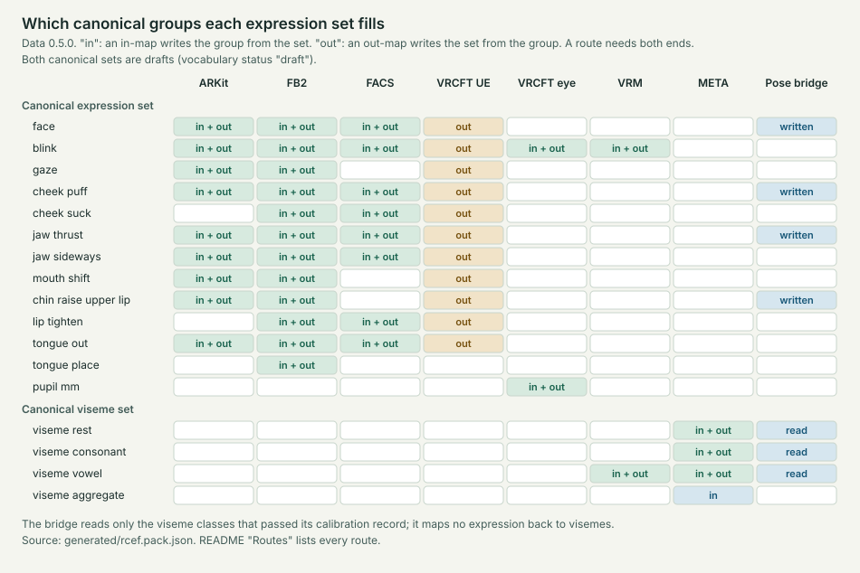

# Reference Canonical Expression Framework (RCEF)

## Purpose

Face trackers and avatar systems each publish their own set of face expression signals. ARKit, OpenXR FB2, MediaPipe, VRCFaceTracking, VRM, Godot and Roblox use different names, scales and calibrations. So you cannot copy a value from one system into another.

The Reference Canonical Expression Framework (RCEF) does four things:

- It records each public expression interface as data, with its calibration limits and a pinned public source.
- It defines a draft canonical expression set of 72 signals and a draft canonical viseme set of 16 signals. A viseme is the mouth shape of a class of speech sounds. RCEF declares the meaning of each signal.
- It defines explicit one-way scalar mappings into and out of the canonical sets. Each mapping states its assumptions and its losses. A translation runs from a source set through a canonical set to a target set.
- It checks all of this with [msf-character-tools](https://github.com/MetaverseStandards/msf_character_tools), a separate project.

RCEF is a pivot for translating between expression sets. It is not a set that everyone must adopt. Each canonical signal has a declared meaning, but no shared or measured gain. The gain of a signal is how far the face moves for a given value.

"Canonical" does not mean one universal anatomy or one shared calibration. The cross-provider mappings are proposed approximations, so RCEF does not claim visual equivalence. RCEF describes the meaning of each signal. The look of a stylized character is a separate layer on top of RCEF.

RCEF records provider names as facts, with attribution. Its definitions and examples are original. [RCSF](https://github.com/MetaverseStandards/RCSF), the Reference Canonical Skeletal Framework, does a similar job for skeletons. It is in the same GitHub organization. Its README is a pinned source for RCEF ([rcsf_readme](references.md#rcsf_readme)).

## Contents

RCEF is mostly data in plain-text TOML files (`key = value` lines). Scripts make everything else from that data.

You edit these files:

- `profiles/`: one file per public expression set, for example ARKit, OpenXR FB2 or VRM. Each file lists the signals of the set, with name, value range, face side, neutral value and public source.
- `data/`: RCEF's own sets. These are the canonical expression set, the canonical viseme set and the helper values that some maps use internally (`intermediate.toml`).
- `mappings/`: the maps. Each mapping names its inputs, outputs and formula, and states its assumptions and losses.
- `evidence/`: the public sources with their revisions and SHA-256 (`sources.toml`), and the lock of the msf-character-tools build that checks the data (`tooling.lock.json`). `input-contracts/` holds an optional schema that RCEF does not use.
- `calibration/`: fits to software renders or mesh geometry of example faces. RCEF tests each fit on held-out data, which the fit did not use. The `FREEZES` ledger only grows. RCEF commits the ledger line of each fit before its results, and Git history shows the order. This does not prove that nobody looked at held-out data before the freeze ([calibration/README.md](calibration/README.md)).
- `pack.toml`: the version numbers, ID and licence of the whole data set.

Scripts write these files. Do not edit them:

- `generated/`: all the data merged into one JSON file (`rcef.pack.json`), a CSV table, a coverage summary and checksums.
- `reports/`: readable Markdown and CSV tables of every signal, every mapping and the correspondence of each set to the canonical sets.
- `data/canonical_expression.toml`, `data/canonical_viseme.toml`, `profiles/facs.code.toml`, `mappings/canonical_*.toml` and the part of `data/intermediate.toml` below its marker line. `scripts/build_canonical.py` writes them from `docs/canonical-set.md`, its audit and the other inputs that [AGENTS.md](AGENTS.md#known-traps) lists.
- `references.md`, `docs/toml-index.csv`, `docs/godot_comparison.md`, the map pages in `docs/map-sets/`, and the figures `docs/routes.svg` and `docs/ab-coverage.svg`.

Code, examples and documents:

- `check.py`, `scripts/` and `tests/`: the main check, the helper programs and the automated tests.
- `examples/`: programs that translate synthetic face frames through the canonical sets and drive 3D example faces ([examples/README.md](examples/README.md)). `fixtures/` holds small made-up inputs with known answers.
- `tools/`: optional [calibration tools](tools/calibration/README.md) and the small macOS [renderer](tools/render/README.md) that they use.
- `ab/`: the registered A/B comparison of the routes with the retired direct maps ([ab/README.md](ab/README.md)).
- `docs/`: the [architecture guide](docs/architecture.md), [getting started](docs/getting-started.md) and the [expression sets](docs/expression-sets.md). It also has the draft [canonical expression set](docs/canonical-set.md), its [definitions audit](docs/canonical-set-audit.md) and the codec for intensities of FACS (Facial Action Coding System) codes ([docs/facs-intensity.md](docs/facs-intensity.md)). The [calibration notes](docs/calibration/) are there too.
- [survey.md](survey.md): one section for each expression set family: source, signals, values, maps and gaps.
- [proposal.md](proposal.md): the proposal to the Metaverse Standards Forum: the problem, the design, the results and the requests to the Forum. Appendix A gives the data format and the API.
- [CHANGELOG.md](CHANGELOG.md), [CONTRIBUTING.md](CONTRIBUTING.md) and [GOVERNANCE.md](GOVERNANCE.md): the changes in each data version, what a change must include, and who owns releases and the release gates. [REVIEW.md](REVIEW.md) is a self-review dated 2026-10-07.
- [AGENTS.md](AGENTS.md) (and `CLAUDE.md`, which points to it): a short guide to the outputs, the commands and the rules that must not break.
- `LICENSE`, `LICENSES/` and [THIRD_PARTY_NOTICES.md](THIRD_PARTY_NOTICES.md): the licences and the credits for public sources. `.github/workflows/check.yml` is a GitHub workflow.

## What RCEF covers

RCEF records the public expression sets in this list. Each number is the count of entries that RCEF selected from the public interface, for example the 52 ARKit coefficients. The numbers do not say how well anything tracks a face.

- ARKit: 52 coefficients.
- MediaPipe: 52 labels.
- OpenXR: FB 63, FB2 70, and the optional META visemes 15.
- VRCFaceTracking: transport 88; raw and combined eye data; artist shapes 102 base and 42 blended; 124 publicly listed numeric avatar parameters; 3 activity flags.
- Godot: 102 base and 41 blended.
- VRM: 18 presets.
- Roblox: 50 face controls.
- FACS: 92 rows for 70 code numbers from a public list (some codes split by side). 49 rows are mapped. RCEF uses its own numeric encoding, not a FACS interface.

RCEF's two canonical sets are between these sets. A map turns the values of one set into the values of another set, and each rule in a map is one mapping. Each mapping has an evidence status. `verified_current` means that the mapping copies a verified provider value exactly. `proposed` means an approximate cross-provider translation that sources support. A proposed mapping compiles only with the approximation opt-in.

These numbers describe the canonical sets and their maps:

- The draft canonical expression set, `rcef.canonical_expression`, has 72 signals in 13 groups. 11 maps with 442 mappings go into and out of it.
- The draft canonical viseme set, `rcef.canonical_viseme`, has 16 signals. 4 maps with 42 mappings go into and out of it.
- The viseme pose bridge joins the two sets with 1 map of 101 mappings.
- Of the 585 mappings in these 16 maps, only the 4 pupil copies are `verified_current`. The other 581 are `proposed`.

Data 0.5.0 retired the direct cross-provider maps of earlier data versions, so every translation runs through the canonical sets. [The canonical sets in data 0.5.0](docs/expression-sets.md#the-canonical-sets-in-data-050) gives the groups, the maps, the bridge and the retired maps.

### Routes

A route runs from a source set through a canonical set to a target set. [examples/rcef_route.py](examples/rcef_route.py) finds the maps of each route in the pack by the sets their signals belong to. This table lists the 37 routes that data 0.5.0 can run. The registered A/B comparison runs all of them ([ab/README.md](ab/README.md)).

A route writes only the target signals of the groups that both sets fill. The route marks the other outputs as "not available from source". A target can be the source set itself (a round trip). VRM appears in three rows: its blinks go through the canonical expression set, and its vowels go through the canonical viseme set.

| Source set | Through | Target sets |
|---|---|---|
| `arkit.coefficient` | canonical expression set | `arkit.coefficient`, `facs.code`, `openxr.fb2`, `vrcft.artist.base`, `vrcft.eye`, `vrm.preset` |
| `facs.code` | canonical expression set | `arkit.coefficient`, `facs.code`, `openxr.fb2`, `vrcft.artist.base`, `vrcft.eye`, `vrm.preset` |
| `openxr.fb2` | canonical expression set | `arkit.coefficient`, `facs.code`, `openxr.fb2`, `vrcft.artist.base`, `vrcft.eye`, `vrm.preset` |
| `openxr.visemes` | canonical viseme set | `openxr.visemes`, `vrm.preset` |
| `openxr.visemes` | canonical viseme set, viseme pose bridge, canonical expression set | `arkit.coefficient`, `facs.code`, `openxr.fb2`, `vrcft.artist.base` |
| `vrcft.eye` | canonical expression set | `arkit.coefficient`, `facs.code`, `openxr.fb2`, `vrcft.artist.base`, `vrcft.eye`, `vrm.preset` |
| `vrm.preset` | canonical expression set | `arkit.coefficient`, `facs.code`, `openxr.fb2`, `vrcft.artist.base`, `vrcft.eye`, `vrm.preset` |
| `vrm.preset` | canonical viseme set | `openxr.visemes`, `vrm.preset` |
| `vrm.preset` | canonical viseme set, viseme pose bridge, canonical expression set | `arkit.coefficient`, `facs.code`, `openxr.fb2`, `vrcft.artist.base` |



`tests/test_readme_sources.py` checks this table against the routes that `examples/rcef_route.py` finds. [docs/routes.svg](docs/routes.svg) shows which canonical groups each set fills, in and out, and [docs/ab-coverage.svg](docs/ab-coverage.svg) shows the A/B result for each route.

### Mappings

For each pair of an expression set and a canonical set, RCEF has at most one map in each direction. Its ID is `<from>.to_<to>`, for example `fb2.to_rcef_expression` (FB2 into the canonical expression set) and `rcef_expression.to_fb2` (back out). A map has one part for each group of the canonical set that it fills. Each map has a page in [docs/map-sets/](docs/map-sets/). The page lists its parts, mappings, operators, evidence and loss keys, and the groups that it does not fill. [The architecture guide](docs/architecture.md#maps-mappings-and-loss-annotations) gives the naming rules.

[reports/mappings.md](reports/mappings.md) lists every mapping with its assumptions, losses and evidence. That report also lists the synthetic test maps (`fixture.affine`, `fixture.bilateral`) and `survey.ambiguous`, a recorded map that cannot run. The tables below do not include them.

A route evaluates each map once per frame, with the partial evaluation of msf-character-tools. If an input is bad, the route refuses only the outputs that read it. If an input is missing, only those outputs become "not available" ([examples/rcef_route.py](examples/rcef_route.py)).

#### Maps into and out of the canonical expression set

| Map | Source set → target set | Mappings | Parts | Evidence status |
|---|---|---|---|---|
| [`arkit.to_rcef_expression`](docs/map-sets/arkit.to_rcef_expression.md) | `arkit.coefficient` → `rcef.canonical_expression` | 60 | 9 | proposed |
| [`facs.to_rcef_expression`](docs/map-sets/facs.to_rcef_expression.md) | `facs.code` → `rcef.canonical_expression` | 53 | 8 | proposed |
| [`fb2.to_rcef_expression`](docs/map-sets/fb2.to_rcef_expression.md) | `openxr.fb2` → `rcef.canonical_expression` | 70 | 12 | proposed |
| [`vrcft_eye.to_rcef_expression`](docs/map-sets/vrcft_eye.to_rcef_expression.md) | `vrcft.eye` → `rcef.canonical_expression` | 4 | 2 | proposed, verified_current |
| [`vrm.to_rcef_expression`](docs/map-sets/vrm.to_rcef_expression.md) | `vrm.preset` → `rcef.canonical_expression` | 2 | 1 | proposed |
| [`rcef_expression.to_arkit`](docs/map-sets/rcef_expression.to_arkit.md) | `rcef.canonical_expression` → `arkit.coefficient` | 52 | 9 | proposed |
| [`rcef_expression.to_facs`](docs/map-sets/rcef_expression.to_facs.md) | `rcef.canonical_expression` → `facs.code` | 49 | 8 | proposed |
| [`rcef_expression.to_fb2`](docs/map-sets/rcef_expression.to_fb2.md) | `rcef.canonical_expression` → `openxr.fb2` | 74 | 12 | proposed |
| [`rcef_expression.to_vrcft_artist`](docs/map-sets/rcef_expression.to_vrcft_artist.md) | `rcef.canonical_expression` → `vrcft.artist.base` | 72 | 11 | proposed |
| [`rcef_expression.to_vrcft_eye`](docs/map-sets/rcef_expression.to_vrcft_eye.md) | `rcef.canonical_expression` → `vrcft.eye` | 4 | 2 | proposed, verified_current |
| [`rcef_expression.to_vrm`](docs/map-sets/rcef_expression.to_vrm.md) | `rcef.canonical_expression` → `vrm.preset` | 2 | 1 | proposed |

#### Maps into and out of the canonical viseme set

| Map | Source set → target set | Mappings | Parts | Evidence status |
|---|---|---|---|---|
| [`visemes.to_rcef_viseme`](docs/map-sets/visemes.to_rcef_viseme.md) | `openxr.visemes` → `rcef.canonical_viseme` | 17 | 4 | proposed |
| [`vrm.to_rcef_viseme`](docs/map-sets/vrm.to_rcef_viseme.md) | `vrm.preset` → `rcef.canonical_viseme` | 5 | 1 | proposed |
| [`rcef_viseme.to_visemes`](docs/map-sets/rcef_viseme.to_visemes.md) | `rcef.canonical_viseme` → `openxr.visemes` | 15 | 3 | proposed |
| [`rcef_viseme.to_vrm`](docs/map-sets/rcef_viseme.to_vrm.md) | `rcef.canonical_viseme` → `vrm.preset` | 5 | 1 | proposed |

#### The viseme pose bridge

The bridge goes from the canonical viseme set to the canonical expression set. It reads only the 11 viseme classes that pass on every held-out rig of the calibration record `viseme-poses.rocketbox-features`. [The viseme pose bridge](docs/expression-sets.md#the-viseme-pose-bridge) tells how RCEF makes it, and [canonical-set.md](docs/canonical-set.md#viseme-pose-bridge) gives its limits.

| Map | Source set → target set | Mappings | Parts | Evidence status |
|---|---|---|---|---|
| [`rcef_viseme.to_rcef_expression`](docs/map-sets/rcef_viseme.to_rcef_expression.md) | `rcef.canonical_viseme` → `rcef.canonical_expression` | 101 | 7 | proposed |

[Not translated yet (planned)](#not-translated-yet-planned) and [Out of scope](#out-of-scope) list the translations that RCEF does not make, and why.

### Expression sets

This table shows which expression sets the maps read or write. Each name is a file in `profiles/` without `.toml`, except `rcef.canonical_expression`, `rcef.canonical_viseme` and `rcef.intermediate`, which are in `data/`. [docs/expression-sets.md](docs/expression-sets.md) gives the revision, signal count, role, documentation, pinned source and licence or terms of each file. It also explains the signal counts and RCEF's own sets.

| Provider | Read or written by a map | Inventory only |
|---|---|---|
| Apple ARKit | `arkit.coefficient` | `arkit.ancillary` |
| OpenXR (FB and META extensions) | `openxr.fb2`, `openxr.visemes` | `openxr.fb`, `openxr.ancillary` |
| VRCFaceTracking | `vrcft.eye`, `vrcft.artist.base` | `vrcft.artist.blended`, `vrcft.transport`, `vrcft.parameter.float`, `vrcft.parameter.flags`, `vrcft.parameter.encoding` |
| VRM 1.0 | `vrm.preset` | none |
| FACS (code numbers from a public list) | `facs.code` | none |
| MediaPipe | none | `mediapipe.label`, `mediapipe.score` |
| Godot | none | `godot.base`, `godot.blended` |
| Roblox | none | `roblox.control` |
| RCEF | `rcef.canonical_expression`, `rcef.canonical_viseme`, `rcef.intermediate` (RCEF's own sets), `fixture` (synthetic) | none |

## Getting started

You need Python 3.11 or newer and the msf-character-tools release wheel that [tooling.lock.json](evidence/tooling.lock.json) locks. Install the wheel by hash, as [docs/getting-started.md](docs/getting-started.md) shows. Then run these commands from the RCEF checkout to check the outputs and run the tests:

```sh
python3 -B check.py
python3 -B -m unittest discover -s tests
```

## Editing the data

Edit the TOML files. Then regenerate the outputs and review the diffs. These two commands check and regenerate the shared outputs and the reports:

```sh
python3 -B check.py            # CHECK: compare the outputs with the TOML. Writes nothing.
python3 -B check.py --write    # APPLY: regenerate generated/ and reports/ from the TOML.
```

Six more scripts write the other generated files. Without `--write`, each script only checks its files and fails if they are out of date:

```sh
python3 -B scripts/build_canonical.py --write     # canonical sets, facs.code and their maps
python3 -B scripts/export_references.py --write   # references.md
python3 -B scripts/export_toml_index.py --write   # docs/toml-index.csv
python3 -B scripts/compare_godot.py --write       # docs/godot_comparison.md
python3 -B scripts/export_figures.py --write      # docs/routes.svg, docs/ab-coverage.svg
python3 -B scripts/export_map_sets.py --write     # docs/map-sets/, one page per map
```

`build_canonical.py` writes `data/canonical_expression.toml`, `data/canonical_viseme.toml`, `profiles/facs.code.toml` and `mappings/canonical_*.toml` from `docs/canonical-set.md` and its audit. The other scripts read the pack, `evidence/sources.toml`, the TOML files or the A/B results.

Any change to a TOML file changes `docs/toml-index.csv`. Any change to a string in a TOML file also changes the pack hash. Then `rcef.pack.json`, `coverage.json`, both `SHA256SUMS` files and the three Markdown reports change too. [AGENTS.md](AGENTS.md#known-traps) says when the CSV files change. Regenerate all the outputs and review each diff. Commit the TOML files and the generated files together.

Each data change also needs an entry in the top section of [CHANGELOG.md](CHANGELOG.md). Data 0.5.0 is a release candidate. Until its tag, a data change goes into its section. After the tag, a data change opens a new section. [AGENTS.md](AGENTS.md#rules-that-must-not-break) says how.

GitHub Actions is not active for this repository. Run `sh scripts/ci_local.sh` instead ([local CI](docs/getting-started.md#run-the-local-ci)). Paste its summary into the pull request.

### Common tasks

[Common changes step by step](docs/architecture.md#common-changes-step-by-step) gives the full steps for each task.

- Fix or add a mapping in an existing map. `scripts/build_canonical.py` writes the maps of the canonical sets (`mappings/canonical_*.toml`), so do not edit them by hand. Change `docs/canonical-set.md` or its audit. Run the script. Then run `check.py --write`, `export_toml_index.py --write` and `export_map_sets.py --write`. A test compares these maps with the latest A/B freeze. A change that keeps every value needs a revise freeze first. A change of value needs a new A/B run first ([ab/README.md](ab/README.md)).
- Add a new map. Add a `[[mappings]]` record in `mappings/`. Regenerate the outputs. Then add its row to the [Mappings](#mappings) table. `tests/test_readme_sources.py` fails until the row agrees with the pack.
- Add or update an expression set. Add its evidence record. Run `export_references.py --write`. Then edit `profiles/<name>.toml`. Update [docs/expression-sets.md](docs/expression-sets.md). Update the [Expression sets](#expression-sets) table.
- Update the msf-character-tools lock. Follow [Update the lock](docs/getting-started.md#update-the-lock).

For each task, add a CHANGELOG entry. Run the tests. Commit the TOML, the generated files and the changed documents together.

## Status

### Data

- [x] 19 profile files record the public expression sets, and `facs.code.toml` records the FACS codes. Each file has pinned sources ([docs/expression-sets.md](docs/expression-sets.md)).
- [x] Draft canonical expression set (72 signals) and draft canonical viseme set (16 signals).
- [ ] Meaning review of the canonical sets and `facs.code` by the working group.
- [ ] Data 0.5.0 tag: the CHANGELOG dates the release candidate 2026-10-30, and the project's release owners tag it.

### Maps

- [x] ARKit, FB2 and FACS codes: an in-map and an out-map with the canonical expression set.
- [x] VRCFaceTracking eye data and VRM per-eye blinks: an in-map and an out-map with the canonical expression set.
- [x] VRCFaceTracking Unified Expressions: an out-map from the canonical expression set.
- [x] META visemes and VRM vowels: an in-map and an out-map with the canonical viseme set.
- [x] Viseme pose bridge from the canonical viseme set to the canonical expression set, for 11 of 15 viseme classes.
- [x] Registered A/B comparison of all 37 routes with the retired direct maps ([ab/README.md](ab/README.md)).
- [ ] Unified Expressions in-map, and maps for MediaPipe, OpenXR FB, Godot and Roblox. These sets are inventory only.

### Calibration

All 5 records in [calibration/](calibration/README.md) are software-only. They are fits to renders or mesh geometry of example rigs. They do not measure a tracker.

- [x] `viseme-poses.rocketbox-features`: 11 of 15 viseme classes pass on all 4 held-out rigs. The viseme pose bridge cites it.
- [x] `rig-gains.ict-rocketbox-female`: 3 of 51 ARKit shapes pass. The 48 that fail stay published as negative results.
- [x] `mediapipe.ict-response`: a negative result. The fit worked for 25 of 51 scores, and none of them passed on held-out data.
- [x] `viseme-poses.rocketbox-female` and `viseme-poses.rocketbox-multi`: kept as history. No mapping cites them.
- [ ] Calibration between providers. No provider publishes its gain.
- [ ] Physical capture with real trackers and real faces. [The protocol](docs/calibration/physical-protocol.md) is a design only. Nobody has run it.

### Not translated yet (planned)

- [ ] MediaPipe to ARKit. Only one independent implementation (three.js) maps MediaPipe to ARKit. RCEF's licence check found no statement in the model card that relates the scores to ARKit coefficients, apart from the shared names.
- [ ] Unified Expressions to ARKit or FB2. There is no map from Unified Expressions into the canonical expression set yet. FB2 to Unified Expressions runs through the canonical expression set.
- [ ] Unified Expressions shapes with no FB2 counterpart, for example pupil dilation and constriction, tongue directions and TongueFlat. No map writes them yet. Cheek suck and mouth tightener come from FB2 through the canonical expression set.
- [ ] FACS gaze codes (61 to 64). The source does not say whose left the gaze codes use. So canonical gaze has no FACS code yet.
- [ ] FACS codes with no canonical signal, for example 25 (lips part) and 27 (mouth stretch). These codes are `unresolved` rows. The codec reads 27 as 26, and 45 and 46 as 43.
- [ ] Viseme sets other than META and the VRM vowels, for example Amazon Polly, or sets with one class for several canonical classes. Each set needs its own audit against the canonical viseme classes before it gets maps.

### Out of scope

RCEF does not plan these translations. They need state, time, classification or an operator for angles, and the current operators have none of these.

- VRM emotions (happy, angry, sad, relaxed, surprised). A classification turns muscle movements into an emotion label. A linear calculation cannot do this. Also, each model authors its own binds.
- VRM `lookUp`, `lookDown`, `lookLeft` and `lookRight`. VRM drives gaze by angle, through range maps whose input is in degrees. FB2 and ARKit publish no maximum angle. A translation needs an operator for angles and curves.
- Expression to viseme. A face pose does not identify the sound, so no map goes from the canonical expression set to the canonical viseme set.
- The combined VRCFaceTracking eye data. The project computes it with state: the combined pupil value uses a minimum and a maximum that change at run time.
- The effect of neighbouring sounds on a viseme. RCEF has no operator over time.

## Open questions

The linked documents state each open item in full.

- Meaning review. The canonical expression set, the canonical viseme set and `facs.code` are drafts (`vocabulary_status = "draft"`). The working group has not reviewed their meaning yet. Acceptance would change only `vocabulary_status`. It would not change IDs or maps ([GOVERNANCE.md](GOVERNANCE.md), [docs/canonical-set.md](docs/canonical-set.md)).
- Calibration between providers. The relation between the calibrations of two providers is not known. Maximum angles and model calibration are unknown, so no cross-provider identity is possible ([survey.md](survey.md#semantics-that-remain-distinct)). No provider publishes its gain, so the mappings assume that equal weights mean equal expressions ([AGENTS.md](AGENTS.md#limits)).
- Missing evidence. RCEF has no evidence yet for MediaPipe model calibration and provenance, FB1 numeric bounds or FB2 maximum angles per direction. It also has none for VRCFaceTracking raw gaze units and source contradictions, or for which Roblox list of required poses is authoritative. These gaps block the derived mappings that depend on them ([proposal.md](proposal.md#release-limits-and-remaining-evidence), [REVIEW.md](REVIEW.md#evidence-and-gates-still-open)). [docs/calibration/mediapipe-licence.md](docs/calibration/mediapipe-licence.md) records a later check of the licence and training-data statements of the MediaPipe model.
- VRM specification prose. RCEF does not know yet if it can redistribute VRM specification prose. So RCEF links to the prose and does not copy it ([REVIEW.md](REVIEW.md#evidence-and-gates-still-open)).
- Mappings not translated yet. See [Not translated yet (planned)](#not-translated-yet-planned) and [Out of scope](#out-of-scope).
- Action unit datasets. A desk review of public facial action unit datasets is in [docs/calibration/datasets.md](docs/calibration/datasets.md). By default, RCEF does not use them in published data, because their terms appear to forbid commercial use and redistribution. The review did not verify the current terms.
- Physical capture. [docs/calibration/physical-protocol.md](docs/calibration/physical-protocol.md) designs a capture with real trackers and real faces. Before any part of it runs, it needs a named owner, an ethics and legal review, and approval from the project's release owners ([GOVERNANCE.md](GOVERNANCE.md)).
- Later gates. Device integration, physical calibration, visual equivalence of geometry, execution of VRM bindings, Roblox certification, native and host acceptance, and standards adoption are later gates. Each one needs its own measured acceptance ([GOVERNANCE.md](GOVERNANCE.md), [REVIEW.md](REVIEW.md#evidence-and-gates-still-open)).

## Licenses

Original code: [MIT](LICENSES/MIT.txt). Original data, documentation and fixtures: [CC-BY-SA-4.0](LICENSES/CC-BY-SA-4.0.txt), attribution to RCEF contributors (2026). Copyright (c) 2026 Metaverse Standards Forum. [THIRD_PARTY_NOTICES.md](THIRD_PARTY_NOTICES.md) keeps the inherited source licenses and provenance. RCEF does not relicense the provider documentation it refers to.
