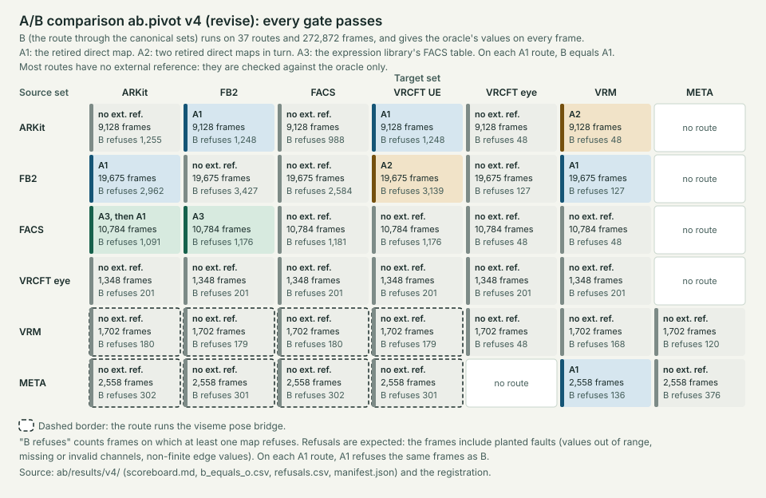

<!-- SPDX-License-Identifier: CC-BY-SA-4.0 -->
# A/B comparison of the pivot route with the direct maps

The pivot route (arm B) translates every pair of expression sets through RCEF's canonical sets: source → canonical → target. This folder holds the pre-registered comparison of B with the direct maps (arm A1) and with the other arms. Data 0.5.0 retires the direct maps from the pack; A1 still runs them from its frozen baseline. Each run is registered before it starts, and its thresholds and frozen lists never change inside a registration.

The tools are in the repository, not in this folder:

| File | What it does |
|---|---|
| [examples/rcef_route.py](../examples/rcef_route.py) | `Route`: runs B, and runs A1 in its one-hop mode. `tests/test_route_runner.py` anchors the one-hop mode to `rcef_translate.Translator`. |
| [scripts/ab_frames.py](../scripts/ab_frames.py) | Makes the input frames from a registration only. It never reads the live pack. |
| [scripts/ab_compare.py](../scripts/ab_compare.py) | Writes a registration draft, checks the pins, runs every arm and writes the results. It also checks this folder. |
| [tests/ab_oracle.py](../tests/ab_oracle.py) | The oracle (O): a pure-Python copy of how msf-character-tools evaluates a map, in whole-map and partial mode, and of how `Route` chains the in-map, the viseme pose bridge and the out-map. It gives B's expected values, refusal codes, labels and notes. |
| [scripts/ab_mutations.py](../scripts/ab_mutations.py) | Metric M7: plants each registered fault in a copy of the B pack and runs the checks that must catch it. |
| [scripts/ab_geometry.py](../scripts/ab_geometry.py) | Metric M6: poses face rigs with each arm's ARKit values and compares the vertices. |
| [tests/ab_a3.py](../tests/ab_a3.py) | Arm A3: the expression library's AU → FB2 table, frozen at dea1713 in `tests/fixtures/a3-dea1713/`. |
| [examples/facs_codec.py](../examples/facs_codec.py) | Reads FACS notation into `facs.code` values, for B's FACS input. Its table is `examples/data/facs_codes.json`. |

## Arms

- **A1:** the pack at dea1713, committed as `tests/fixtures/baseline-dea1713.pack.json` (SHA-256 `630d37a5b01e4983f8e5cbcbd54d8268abeffb09248ea793d4842bd2df5cd4f7`). `ab_compare.py` checks the hash, and also checks the file against Git when the history is there. A1 always comes from this file, never from the live pack.
- **A2:** two direct maps in turn, only where no direct map exists: FB2 → ARKit → VRCFT UE, and ARKit → FB2 → VRM blink.
- **A3:** the expression library's AU table, for FACS → FB2. **A3 then A1** gives FACS → ARKit.
- **B:** `Route` on the B pack.
- **O:** the oracle, on B's maps. It evaluates each map output by output, as msf-character-tools does with `partial=True`: an output that reads a bad input is refused, and an output that reads a missing input is not available. On a route through the viseme pose bridge, O runs the in-map, then the bridge (copy, weighted sum, clamp), then the out-map. A bridge input that the in-map of the route does not write counts as 0, and the frame gets the same note as from `Route`. A bridge input that the in-map refused leaves the bridge outputs that read it unwritten, labelled "refused upstream at" the in-map.
- **References:** R1 and R2 (M5), R3 (M8 R3) and **R5**, ICT-FaceKit's FACS table (M11). `python3 -B scripts/ab_compare.py r5 README` writes R5 to `tests/fixtures/ict_facekit_facs.json` from the README of record `ict_facekit`, after checking the record's SHA-256.

## Files in this folder

- `FREEZES`: the ledger (below).
- `<id>-v<N>.abreg`: one registration per freeze, for example `ab.pivot-v1.abreg`. It is JSON, not TOML, because msf-character-tools reads every `.toml` file in the checkout as pack authoring.
- `results/v<N>/` (for `ab.pivot`) or `results/<id>-v<N>/` (for a new A/B): the results of one registered run.

## The ledger

`FREEZES` uses the line format of `calibration/FREEZES`:

```
<id> v<N> <abreg_sha256> <YYYY-MM-DD> [reason]
```

- `abreg_sha256` is the SHA-256 of the registration's compact, key-sorted JSON, so it does not depend on the file's layout.
- Versions of an id start at v1 and go up by one. Dates never go back. Every version after v1 needs a reason of at least three words.
- Every registration that is ever committed gets a line, abandoned ones included, so a registration that is made again is still visible. A registration file is never removed.
- Lines are only added at the end.

`check.read_ledger` reads the file, and `tests/test_ab_registration.py` checks it with the rules of this page (`python3 -B scripts/ab_compare.py check` prints the same problems).

## Freeze kinds

A registration's `kind` is one of five:

| Kind | When | Seeds |
|---|---|---|
| `first` | `ab.pivot` v1. | A new `seed_root`. |
| `fix` | After a failing run: B, the oracle, the generator, the codec, the A3 harness, `Route` or `ab_compare.py` changes. The registration says what changed. Thresholds stay. | A new `seed_root` from its own registration. The families of every earlier freeze become regression families, labelled "seen before the change". |
| `revise` | After a passing run: B changes but keeps every value, for example a rename, new definition text or finer refusals. The registration names the freeze it `revises` and lists each change, and the project's release owners accept the list before the run. A rename carries a frozen old → new ID map (`map_renames`), and the pairs must be the revised freeze's pairs with the renames. The run checks the **Revise** gate on every pair and family: it runs the revised freeze's `Route`, taken from Git by its pinned hash, on the revised freeze's pack, and compares B with it. B's values must be bit-identical on every output both write. B must write every output that the revised freeze wrote, and B may refuse only outputs that it refused. Its dropped inputs must be equal, and its notes must be kept, with the renames. B may write an output that the revised freeze refused, or label it "not available" instead; the gate counts these as finer refusals. | A new `seed_root`; earlier families become regression families. |
| `reproduce` | The re-run of an unchanged B, after the direct maps are retired. It reproduces the latest passing `first`, `fix` or `revise` freeze. | It copies that freeze's `seed_root`, generator hash, channel lists and runtime pins. |
| `new` | A new A/B, with a new id such as `ab.pivot2`: when A1 itself changes, or when an intended value difference is accepted. Its v1 sets its own thresholds. | A new `seed_root`. |

Thresholds never change inside an id. A frozen list that changes from one version to the next needs the project's release owners' acceptance, written in the registration's `acceptance` table under the list's name.

## The seed rule

- For a `first`, `new`, `fix` or `revise` freeze, `seed_root` is the SHA-256 of the registration's compact, key-sorted JSON without the `seed_root` field. A `reproduce` freeze copies it.
- Seed *i* is the first 8 bytes, big-endian, of `sha256("<seed_root>:<i>")`, as for calibration records. *i* is the family's place in the registration's `families` list.
- The generator draws numbers only with `getrandbits`, whose output for a seed does not change between Python versions.

Anyone can compute `seed_root` from a registration that is not committed yet. So the held-out frames are held out by procedure: the ledger, the registration test, and the order of the commits below. The scoreboard says so.

## Fixed inputs: the edge set and the impulse frames

These families are fixed lists. They do not depend on `seed_root`, so every A1 figure in a registration (A1's refusals on the edge set and A1's observed loss) is computed before `seed_root` exists, in one pass. `ab_compare.py` checks this by computing the figures again from the registration with its `seed_root` field removed, and comparing them with the recorded ones.

- **Edge set:** each of these values on every channel at once, and on each channel alone: ±0, 1, 2⁻³⁰, 0.1, 0.3, 2⁻⁵⁴, 2⁻⁵³, 0.5 and its two neighbours, the value below 1, float32 roundings of 0.1, 0.3, 1/3 and 0.7, 5e-324, 1.5e-323, (1 + 2⁻⁵²)·2⁻¹⁰²¹, 2⁻¹⁰²⁰ and 2⁻¹⁰²². Then each pair of opposing gaze directions at (0.3, 0.1), (0.1, 0.3), (0.3, 0.3) and (1, 1).
- **Impulse frames:** the all-zero frame, then each channel alone at 1 and at 0.5.
- **Grid frames:** every channel at k/16 for k = 0 to 16, then each pattern of validity flags on a frame with every channel at 0.5.
- **Other fixed inputs:** the goldens in `tests/fixtures/fb2_goldens.json` (each on its source set, every other channel 0), the R3 goldens in `tests/fixtures/fb2_vrcft_ue_goldens.json` (the same way), the four example CSVs, the 221 FACS library frames and the 132 FACS key impulses. The registration pins the SHA-256 of each input file.

The seeded families mix full-mantissa binary64 values with 6-decimal values. Each family's value range (or, for the FACS letter family, its value set, and for the viseme family its number of decimals) is written in the registration, and the generator has no default for it, so a change to the generator cannot change a registered family. The viseme simplex family uses 6-decimal values only: it splits 10⁶ at random cut points, so each frame's probabilities sum to exactly 1 in decimal, which full-mantissa values cannot do. The perturbation families leave out each input of a few seeded frames, set it to 1.5 and to −0.1, and clear each validity flag.

## Registration order

1. `python3 -B scripts/ab_compare.py draft OUT.abreg --date YYYY-MM-DD` writes a draft outside this folder. It pins the channel lists, the input hashes (R2, R3 and R5 included), the hashes of every file a run reads (`ab_compare.CODE`: the code of each arm and metric, and the generator, documents, calibration record and fixtures that M7's checks read), the runtime, the rig files and the B pack, freezes the maps of each pair B routes (in-maps, bridges and out-maps), computes the A1 figures and writes the frozen lists below.
2. The project's release owners review the registration, the frozen lists most of all. If a list must change, change it in the draft and compute `seed_root` again (`ab_compare.seed_root`).
3. Commit the registration to this folder. Then, in a later commit, add its line to `FREEZES`.
4. Run it: `python3 -B scripts/ab_compare.py run ab/ab.pivot-v1.abreg ab/results/v1`. A run whose pins do not match the checkout is refused. `--dry-run` runs anyway and marks the results as not registered.
5. Commit the results. Merge without squashing, so the commit order stays visible.

## Results

`results/v<N>/` holds:

- `scoreboard.md`: one row per metric with its threshold and status, and one row per pair with the evidence status, the M2c shortfall, M4b and whether an external reference exists ("no external reference" for pairs only B runs);
- one CSV per metric, a `*_failures.csv` that lists every failing frame or output, and `refusals.csv`, `losses.csv` and `assumptions.csv`;
- `manifest.json`: the freeze id, version, kind, the registration hash, every code and input hash and the runtime;
- `SHA256SUMS`: the hash of each result file and of each generated frame file;
- `timings.json`, which no hash covers.

Four registered runs have passed: `ab.pivot` v1 (`first`), v2 (`reproduce`, after the direct maps were retired), v3 (`revise` of v2: one map per set pair and direction, evaluated with partial evaluation) and v4 (`revise` of v3: the evidence claim of the re-frozen pose record names its version 2). Every gate of each passes. In v3 the Revise gate finds no value difference on 195,344 frames; on them B writes 611,836 outputs that v2 refused, and labels 30,472 outputs that v2 refused "not available from source". It refuses no frame that v2 did not refuse. In v4 the Revise gate finds no value difference on 272,872 frames, no output that v3 wrote and v4 does not, and no new refusal. [docs/ab-coverage.svg](../docs/ab-coverage.svg) shows the latest run route by route: the external reference, the frames and the frames that B refuses. `scripts/export_figures.py` writes it from `results/v<N>/`, and `tests/test_figures.py` checks that it is current.



Freeze ids, hashes and paths are only in `manifest.json`. So a `reproduce` run can match the results of the freeze it reproduces byte for byte, apart from `manifest.json`, its line in `SHA256SUMS`, and `timings.json`, which has no line there.

## Frozen lists

A draft writes these lists from the definitions audit, the R5 fixture and the data. Each is frozen with the registration.

- `reason_key_table` (M4 keys): one entry per (A1 rule, A1 loss reason), 313 in all over the 21 reasons of [Mapping today's losses to keys](../docs/canonical-set-audit.md#mapping-todays-losses-to-keys). Each entry names the B losses that must be on the route of that rule, by side: an audit key, or the exact text of a loss that has no key (for example the gain loss of each hop). `audit_keys` lists the audit's keys, and `audit_added_keys` holds, for each pair, the keys of [Keys added on today's pairs](../docs/canonical-set-audit.md#keys-added-on-todays-pairs).
- `assumption_catalogue` (M4b): one entry per (A1 rule, template), 589 in all over the 35 templates of the [assumption catalogue](../docs/canonical-set-audit.md#assumption-catalogue). The templates are read from the audit's table, and every assumption string of today's maps must match exactly one. An entry names the hop assumption keys the route needs, by side, or the cited reason why the canonical definition supersedes it (178 entries). Where the rule cites a crosswalk, the entry needs `transfer.provider` when both sets' audit rows for the canonical signal are `same`, and `transfer.withdrawn` when either is `differs` or `unresolved`.
- `no_target` (M4): source inputs whose impulse moves no output by design: inputs that write a bridge class whose pose is the rest face (every weight 0) and have no link to any output. Today these are META SIL on the four META routes through the pose bridge.
- `m7_mutations` (M7): the planted faults and the checks that must catch each.
- `m11_differences` (M11): the ICT-FaceKit rows where B departs on purpose.
- `m3_flat_links`, `m3_rounding`, `m10_not_available`, `m10b_not_available`, `r3` and `r2_departures`, as before. A weighted-sum input with weight 0 carries nothing, so it is not a link for M3.

## What the tools compute today

`ab_compare.py` computes every metric of the design:

- M1, M1s, M2, M2b, M2c, M3, M4 (observed loss), M5, M8 (B against A2 and against R3), M10, M10b, and B against O on every pair, the pairs through the pose bridge included.
- **M3 exact** also bounds the outputs it does not hold to 0 error: the rounding outputs (FB2 gaze on the negative knot segment, and VRCFaceTracking Openness) within 2⁻⁵⁴ on exclusive frames, because fl(1 − fl(1 − x)) is within 2⁻⁵⁴ of x; and each FB2 gaze output, on frames that break FB2's exclusivity, within the smaller input of its pair plus 2⁻⁵². A value past its bound fails.
- **M4 keys:** on each A1 pair, every entry of `reason_key_table` must find its B losses on the route of its rule, on the named side; and every audit key on the route that no entry names must be in `audit_added_keys`. Today's internal gaze steps write no output, so their route is the routes of the rules that read them.
- **M4b:** every entry of `assumption_catalogue` must find its hop assumption keys on the route, on the named side, or be superseded with its reason. `assumptions.csv` lists every entry.
- **M6 (report):** with `--rig rocketbox-female=DIR --rig ict=DIR`, FB2 → ARKit (B and A1, on the goldens and the example CSVs) and FACS → ARKit (B and A3 then A1, on the FACS frames) pose Rocketbox Female_Adult_01 and ICT-FaceKit. Only the outputs that both arms write pose the rig. Each row says how many ARKit outputs the rig binds: 52 on Rocketbox, 14 on ICT-FaceKit, whose 16 shapes include halves of browInnerUp and cheekPuff. The harness first checks itself: zero weights give the rest positions, each bound shape moves a vertex, and the same weights give the same positions. Without `--rig`, M6 stays pending.
- **M7:** each of the 12 mutations is applied to a copy of the B pack. The checks are M1 and M2 on the A1 pairs, M3 exact on the round trips, M10, M4 keys, M4b, the side, direction-suffix, one-map and audit loss-key tests of `tests/test_pivot_structure.py`, the weight and chain tests of `tests/test_pose_bridge.py`, and the calibration check of `check.py`. Each check a mutation names must fail on the changed pack, and none may fail on the unchanged pack. A test class that cannot be set up on a changed pack catches nothing and fails M7. The VRCFaceTracking eye swap changes both of its hops, so only the side test can catch it: no other set reaches those signals. The pose bridge has no external reference and O reads the same pack as B, so two mutations change its data: a pose weight (caught by the weight test and the calibration check) and a clamp knot (caught by the chain test).
- **M11 (report):** for each of the 29 rows of R5, the ARKit shapes that B links to the row's `facs.code` outputs on ARKit → FACS, against ICT's shapes. A row is `same`, a listed difference, an unlisted difference, or listed but the same.

The draft takes the M3 list of flat links from O: links of the composed hop weights that enter a piecewise operator on its flat side, so their impulse changes nothing. A `fix` or `revise` run makes the seeded families of every earlier freeze again with the generator that freeze pinned, taken from Git history, and checks their hashes against the earlier run's `SHA256SUMS`. A metric whose table a registration does not hold stays pending, and a run with a pending metric cannot pass.

**R3** is FB2 → Unified Expressions as an avatar with the Unified base shapes gets it from Godot: the OpenXR vendors plugin sets each Godot shape from an FB2 weight or to a constant, and the face modifier drives the part shapes instead of a blended shape when the avatar has every part. `scripts/derive_fb2_goldens.py` writes it from the pinned Godot and VRCFaceTracking sources and never reads RCEF's maps: 73 shapes, 65 set from one FB2 weight and 8 left at 0 inside a blended shape that Godot sets from FB2. M8 R3 is a report. B departs from R3 by design on 9 shapes, which a draft lists in `lists.r3`: BrowPinch and MouthCornerSlant on each side and the four MouthUpper and MouthLower shapes (Godot leaves them at 0, where B copies the canonical value into each part), and TongueFlat (Godot fills it from TONGUE_RETREAT, which RCEF does not map).

A1's observed loss on the fixed impulse frames is 0 on all five A1 pairs (`python3 -B scripts/ab_compare.py a1-loss`). The first registration records it as A1's baseline.
