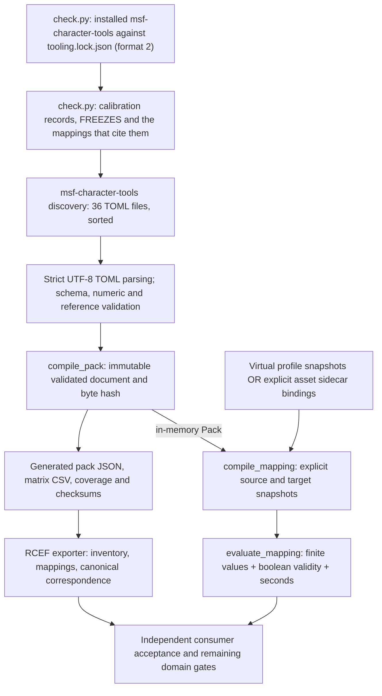
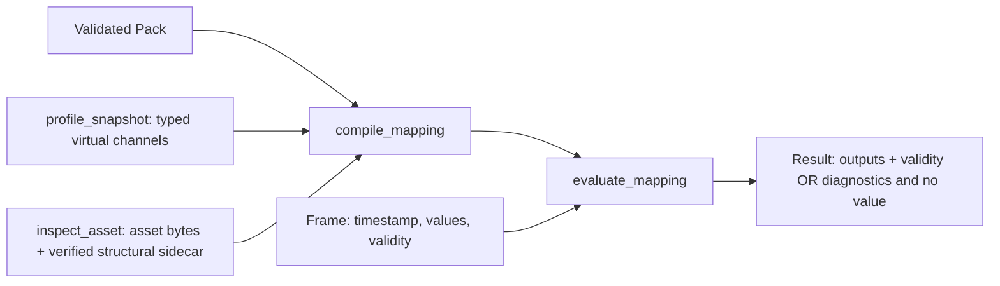

<!-- SPDX-License-Identifier: CC-BY-SA-4.0 -->
# RCEF architecture: from TOML to explicit scalar mappings

RCEF records public expression interfaces and explicit one-way scalar mappings between them. TOML is the authoritative authoring format. MSF Character Tools (msf-character-tools) supplies the parser, the validator, the deterministic pack compiler, the mapping compiler and the evaluator. RCEF adds its data, numerical fixtures, calibration records, readable reports and consumer acceptance tests.

The [offline visual report](architecture.html), the [SVG](architecture.svg) and [PNG](architecture.png) views and the [TOML index](toml-index.csv) describe the same tree as this guide. Links in this guide are relative to `RCEF/docs`. Links to msf-character-tools assume a sibling `msf_character_tools` checkout.

## Scope of this guide

This guide describes `rcef.parity` data version **0.5.0**, schema **1.0** and operators **1.1**, checked with msf-character-tools 0.6.0, installed from its release wheels. The locked commit is in [tooling.lock.json](../evidence/tooling.lock.json). The counts below were recomputed with the Python standard library from all 36 authoritative TOML files, and they agree with `generated/rcef.pack.json`. They are inventory counts: they include ancillary, excluded, unsupported and unresolved rows. They are not counts of selected interfaces, and they do not measure tracking quality.

| Measure | Total |
| --- | ---: |
| Distinct signal IDs | 1165 |
| Profiles | 26 |
| Profile membership rows | 1170 |
| Maps (`[[mappings]]` records) | 19 |
| Mappings (rules) | 588 |
| Evidence records | 81 |
| Canonical expression signals (draft) | 72 |
| Canonical viseme signals (draft) | 16 |
| RCEF intermediate signals | 61 |
| FACS code signals (draft, `facs.code`) | 92 |

Five fixture signals are in both the aggregate fixture profile and its source and target profiles. That gives 5 distinct signals but 10 memberships, which explains the difference of five rows. Also, `godot.blended.toml` has 42 actual rows, while its selected interface has 41; the counts here include every actual row. See the full [inventory](../reports/inventory.md).

Signal dispositions: 423 mapped, 682 unresolved, 6 unsupported and 54 excluded. Mappings: 587 mapped (5 exact, 582 approximate) and 1 unresolved. Operators: 472 `affine`, 1 `identity`, 61 `weighted_sum` and 54 `piecewise_linear`. A `mapped` signal does not guarantee that every requested map or frame can be executed.

## 1. Architecture and ownership



`check.py` runs two RCEF checks before msf-character-tools runs. Then discovery, validation and pack compilation lead to two separate paths: one for runtime and one for exported files. The msf-character-tools map and evaluate commands load the TOML again and compile an in-memory Pack. They do not read the generated JSON, matrix CSV or coverage files. The report exporter reads the generated pack JSON directly. It does not read scalar frames or render geometry. An evaluation `Report`, which holds diagnostics and losses, is a different thing from a readable Markdown or CSV report.

| Owner | Supplies or implements | Boundary |
| --- | --- | --- |
| RCEF | `pack.toml`; provider and canonical inventories; profiles; evidence; directional maps; numerical fixtures; calibration records and `calibration/FREEZES`; `check.py`; report exporter; calibration tools; tests | Declares meaning and provenance. It does not implement the shared scalar algorithms. |
| MSF Character Tools | Authoring discovery and validation, `compile_pack`, `profile_snapshot`, `compile_mapping`, `evaluate_mapping`; asset inspection and sidecar binding | Implements the reviewed wire and operator contracts and their refusals. |
| Independent reviewer or consumer | Review changed bytes and meaning; run the drift check and tests with the locked msf-character-tools | Executable correctness alone does not show visual, anatomical, cross-provider or physiological equivalence. |

Sources: [RCEF launcher](../check.py), [MSF authoring](../../msf_character_tools/msf_character_tools/authoring.py), [pack compiler](../../msf_character_tools/msf_character_tools/pack.py), [mapping compiler and evaluator](../../msf_character_tools/msf_character_tools/mapping.py), the [C++ core](../../msf_character_tools/core/src) behind them, [report exporter](../scripts/export_reports.py), [calibration tools](../tools/calibration/README.md), [tests](../tests/).

## 2. What check.py does

`check.py` runs these steps in order and stops at the first failure.

1. **Locked msf-character-tools.** It checks the installed `msf_character_tools` package against [tooling.lock.json](../evidence/tooling.lock.json). If anything is different, it lists the problems, prints `Refusing to check` and exits 2. [The msf-character-tools lock](#the-msf-character-tools-lock) gives the rules.
2. **Calibration records.** It reads every `*.cal` record in [calibration/](../calibration/README.md) and the freeze ledger `calibration/FREEZES`. Each record must match the record format, and its frozen hash must be the latest one in the ledger for its id. Any mapping that cites a record (evidence id `calibration.<id>`) must use `piecewise_linear` with exactly the record's frozen knots, or be a `weighted_sum` pose sum whose weights are exactly the record's frozen poses, and every held-out cell of each channel it reads must pass. This step does not use msf-character-tools. In data 0.5.0 the 45 weighted sums of the viseme pose bridge cite `viseme-poses.rocketbox-features`.
3. **Shared outputs.** It runs `python -B -P -m msf_character_tools check AUTHORING --pack PATH --csv PATH [--write]` on the checkout, with an empty bytecode cache, so that the subprocess imports the verified package. With `--write` it regenerates the pack, the CSV, coverage and checksums. Without it, it checks that they have not drifted.
4. **Readable reports.** If step 3 passes, it runs [export_reports.py](../scripts/export_reports.py) with the same write or check choice.

### The msf-character-tools lock

The lock is format 2. It records the msf-character-tools commit and version, and one entry per wheel tag. Each entry has the wheel's SHA-256, when known, and a SHA-256 for every file in the installed `msf_character_tools` package, of any type, not only the Python files. The lock's `source` URL is for information only.

One lock serves several Pythons. `check.py` reads the wheel tag of the install from its `WHEEL` file, and checks the install against the entry for that tag.

Before it does anything else, `check.py` checks all of these:

- The installed package was built from the locked commit. `check.py` reads the commit from `msf_character_tools/_build_info.json`. If that file is missing, it reads the commit from the `direct_url.json` of a Git install. If both name a commit and they differ, it refuses.
- The wheel tag of the install has an entry in the lock.
- Every file in the package directory, of any type, matches both its `RECORD` entry and the lock. Bytecode caches are ignored.
- `msf_character_tools` is imported from that installed distribution, and not from somewhere else (for example through `PYTHONPATH`).

`check.py` compares the wheel hash after installation only if the installer recorded it. uv does not record it, so for uv installs `--require-hashes` checks the hash at install time. The commit and the file hashes identify the package, so `check.py` accepts local `file://` installs. Checking never clones or downloads anything.

**Adopt a new release.** Install the reviewed wheel by hash, then run `python3 -B check.py --update-lock`. Add `--wheel PATH` to record the SHA-256 of the wheel file you installed; `check.py` first confirms that the wheel holds the installed files. Run the command once from each Python whose tag you support. Entries for the same commit and version are merged. When the commit or the version changes, the old lock is kept as `evidence/tooling.lock.previous.json`, and the new lock has only the new tag. Always give `--wheel` after a uv install. uv does not record the wheel's hash, so without `--wheel` the tag's `sha256` becomes `null`, and installs by hash then fail for that tag.

**Roll back.** `tooling.lock.previous.json` holds the lock of msf-character-tools 0.5.0, the first release from its repository in the Metaverse Standards Forum organization. To roll back, copy `tooling.lock.previous.json` over `tooling.lock.json`, install msf-character-tools at its commit, and use the `check.py` from the same RCEF commit as that lock.

### Calibration records and the held-out provenance check

A calibration record is a software-only fit, made from renders or mesh geometry of example rigs. Its frozen part (everything except `cells`) is hashed, and the hash is written to `calibration/FREEZES` and committed before the held-out run. The held-out seeds come from that hash. Three records exist:

- `mediapipe.ict-response`: a negative result. 25 of MediaPipe's 51 ARKit-named scores could be fitted, and none passed on held-out data.
- `rig-gains.ict-rocketbox-female`: 3 of 51 ARKit shapes pass; 48 fail and are published as negative results.
- `viseme-poses.rocketbox-female`: the pose of each canonical viseme class, fitted to Rocketbox Female's viseme shapes in her ARKit shapes, on mesh geometry only. 9 of 15 classes pass on Rocketbox Male. No mapping cites it now.
- `viseme-poses.rocketbox-multi`: the pose of each canonical viseme class, fitted to the viseme shapes of 10 Rocketbox rigs. Version 2 (Left and Right tied) passes 7 of 15 classes on its 4 held-out rigs. Version 3, in the checkout, is version 2 frozen again after the history rewrite, with the same cells. No mapping cites it now.
- `viseme-poses.rocketbox-features`: the pose of each canonical viseme class, fitted to 18 Rocketbox rigs with Left and Right tied, with a perceptual gate (visible mouth features with frozen tolerances) for 4 classes. 11 of 15 classes pass on all 4 held-out Rocketbox rigs, 7 by their shape and 4 by the perceptual gate; the viseme pose bridge reads only those.

The calibration tools in [tools/calibration/](../tools/calibration/README.md) run the held-out step. Before they render anything, [provenance.py](../tools/calibration/provenance.py) checks that the record's `code_commit` is in the checkout's history and that no file the run imports has changed since that commit. The tools also check that every cached input has the SHA-256 the record pins and that the installed msf-character-tools passes the lock check. `k3_heldout.py` also requires the renderer binary that the record names. `check.py` cannot see Git history, so reviewers check that the ledger line was committed before the results.

## 3. How TOML is discovered and read

`load_authoring` accepts one TOML file or a directory that contains `pack.toml`. A single file must contain the complete authoring document, including all four top-level arrays. When it loads a directory, it starts with four empty arrays and merges the files it finds.

Directory discovery walks the tree and includes every file name that ends in lowercase `.toml`. It skips directories and files whose names begin with `.`, and directories named `generated`. It refuses symlinks in the authoring tree, and it sorts all file paths before it merges them. It also refuses paths that differ only in letter case and reserved file names such as `CON` or `NUL`. Each fragment must be a regular file.

**Folder names do not choose a schema.** `profiles/`, `mappings/`, `data/` and `evidence/` only organize the repository. The top-level keys in each parsed file decide what is added. Any new TOML file in the discovered tree is read, including a TOML example placed under `docs/`. Keep standalone authoring examples outside the tree or inside Markdown code fences. For this reason, calibration records are named `*.cal` and `tools/calibration/results/mediapipe_arkit.rules` is not named `.toml`.

| Location | Role | Files | Signals | Profiles | Memberships | Maps / mappings | Evidence |
| --- | --- | ---: | ---: | ---: | ---: | ---: | ---: |
| [pack.toml](../pack.toml) | Root metadata | 1 | 0 | 0 | 0 | 0 / 0 | 0 |
| [data/canonical_expression.toml](../data/canonical_expression.toml), [data/canonical_viseme.toml](../data/canonical_viseme.toml) and [data/intermediate.toml](../data/intermediate.toml) | The draft canonical expression and viseme sets and the intermediate values, each with its profile | 3 | 149 | 3 | 149 | 0 / 0 | 0 |
| [profiles/fixture.toml](../profiles/fixture.toml) and the provider profile files | Signal arrays and profile arrays | 21 | 1016 | 23 | 1021 | 0 / 0 | 0 |
| [mappings/fixtures.toml](../mappings/fixtures.toml) and the other mapping files | Arrays of directional maps | 10 | 0 | 0 | 0 | 19 / 588 | 0 |
| [evidence/sources.toml](../evidence/sources.toml) | Evidence array | 1 | 0 | 0 | 0 | 0 / 0 | 81 |

Each of the five root metadata keys appears once in the whole directory. A repeated metadata key is refused, even if its value is the same. The top-level `signals`, `profiles`, `mappings` and `evidence` must be arrays. They are added in file order, and each file's array order is kept.

### Pack metadata and versions

[pack.toml](../pack.toml) has these five scalar keys and no others:

```toml
schema_version = "1.0"
data_version = "0.5.0"
operator_version = "1.1"
id = "rcef.parity"
license = "CC-BY-SA-4.0"
```

The merged document needs all five keys and the four arrays. msf-character-tools 0.6.0 accepts schema versions `"1.0"` and `"1.1"`, and operator versions `"1.0"` and `"1.1"`. Operators 1.1 add `piecewise_linear`; a mapping that uses it under operators 1.0 is refused. Schema 1.1 adds the evidence status `calibrated_software`; RCEF uses schema 1.0. `data_version` has its own version number, and it must be a semantic version: three numbers, with an optional prerelease suffix. Do not invent operators or extra root keys.

### Arrays, tables and references

- `[[signals]]`, `[[profiles]]`, `[[mappings]]` and `[[evidence]]` add records to top-level arrays. `[signals]` would make an object instead, and it fails the array check.
- `signal_ids = ["a", "b"]` is an ordered array of strings. `rules = [{...}, {...}]` is an ordered array of inline objects. Repeated `[[mappings.rules]]` tables are the long way to write a map's rule array.
- `domain = { min = 0.0, max = 1.0 }` is a nested object. A `[signals.domain]` table after `[[signals]]` describes the domain of the latest signal. Table scope continues, so put a signal's own fields before you open its nested tables. `[mappings.rules.operator]` describes the latest rule's operator.
- TOML dotted **keys** make nested objects. Dots inside a string **ID** are only characters. `"arkit.coefficient.eyeBlinkLeft"` must be written exactly; if you change `Left` to `left`, it is a different ID.
- IDs are non-blank strings. They are case sensitive and are not trimmed or normalized. Signal, profile, map and evidence IDs are unique within their category. Rule IDs are unique across all maps. Arrays of string references refuse duplicate entries.
- Profile `signal_ids`, rule `inputs` and `outputs`, and evidence references must name existing records. `label`, `native_id`, `region`, `side` and a similar-sounding anatomy are not references.
- JSON object keys are sorted when written; arrays keep the authoring order. Profile column order follows profile order. Weighted-sum weights follow input order. Compilation repeatedly takes all mappings whose inputs are ready, in authored order. So dependencies run first, and authored order is kept within each batch. Independent rules in different batches can change their relative order.

Parsing is strict UTF-8 with `tomllib.loads`. TOML syntax errors and duplicate keys are reported before schema checks. The msf-character-tools validator refuses unknown keys, missing keys, invalid enums, duplicate IDs, references to records that do not exist, and invalid numbers or domains. The document must be JSON-compatible: TOML dates and times are not accepted as values, and NaN, infinity and booleans are refused as scalars. The pipeline never executes text from TOML, and it does not infer conversions from provider names.

Sources: `load_authoring`, `authoring_files`, `_read_fragment` and `validate_authoring` in [authoring.py](../../msf_character_tools/msf_character_tools/authoring.py).

## 4. Authoring field reference

These tables describe the strict validator. Format-specific inventory details go inside `metadata`. Extra keys anywhere else are refused; they are not extensions.

### Signals

| Fields | Requirement and meaning |
| --- | --- |
| `id`, `label` | Required, non-blank: identity and display name. |
| `value_type` | Required; only `"scalar"` for now. |
| `units`, `calibration` | Required non-blank strings that state the quantity and basis. Units `"unknown"` keep the uncertainty visible. A calibration string is a declaration, not a measurement procedure. |
| `domain` | Required object with only optional finite `min` and `max`. `{}` declares no bounds. When both are present, `min <= max`. |
| `disposition` | Required: `mapped`, `unsupported`, `unresolved` or `excluded`. The inventory record stays even when it cannot be executed. |
| `evidence`, `evidence_status` | Required: an array of evidence IDs (it can be empty in the inventory) and `verified_current`, `proposed` or `unresolved`. Execution is stricter. |
| `neutral`, `native_default` | Each optional: a finite number within the domain. Neutral is the stated calibrated reference. The native default is the value storage starts with. Neither one is used as a fallback at runtime. |
| `region`, `side`, `native_id`, `surface`, `time` | Optional non-blank descriptions. Time text does not convert a provider clock. |
| `coupling` | Optional: one non-blank description or an array of unique non-blank descriptions. It does not create a runtime state policy. |
| `validity` | Optional: a boolean or a non-blank description. It describes the source contract. Actual frame validity is supplied separately. |
| `confidence` | Optional: a non-blank description or a finite number in [0,1]. It does not imply a threshold. |
| `metadata` | Optional object for inventory details, reasons and definitions. It is never executed. |

The ARKit left blink input is scalar, with units `1`, domain `[0,1]`, side `left`, neutral `0.0`, and this calibration:

`arkit.coefficient.v1:eyeBlinkLeft: face-relative native neutral-to-maximum coefficient`

Its native ID is `eyeBlinkLeft`. Its canonical counterpart, `rcef.canonical_expression.eye_close_left`, has the same value type, units, domain, side and neutral. Its calibration is the canonical one, `rcef.canonical.v1:eye_close_left`, which is assumed, not measured, to agree with each source at 0 and 1. See the [ARKit source record](../profiles/arkit.coefficient.toml) and the [canonical expression definitions](../data/canonical_expression.toml).

### Profiles and evidence

| Record | Required fields | Optional fields and constraints |
| --- | --- | --- |
| Profile | `id`, `label`, `signal_ids` | `evidence`, `metadata`. Membership is an ordered array of signal IDs; it does not repeat the signal definitions. |
| Evidence | `id`, `claim`, `status` | Only `url`, `revision`, `retrieved`, `sha256`, `locator`, `license`, `authorship`. All values are non-blank strings. |
| Public evidence | Evidence fields, an HTTPS `url`, `locator`, and at least one of `revision`, `retrieved` or `sha256` | A digest, if given, is exactly 64 lowercase hexadecimal characters. The source verifier needs digests on the URL records it downloads. |
| Original evidence | Evidence fields, with `license` and `authorship` when there is no URL | `rcef_definitions` credits the synthetic fixtures and the intermediate values to RCEF contributors (2026), CC-BY-SA-4.0. |

Example: evidence `apple_blendshapes` claims 52 coefficient identifiers, a native 0..1 domain and face-relative sides. It records the locator `topicSections except initializer; Discussion`, retrieval `2026-10-26`, revision `retrieval-digest`, and digest `c7a074ab7e8b14bfe15d727a8a856a8bdf8f83cb84f1b08d0f8b4a2b458300e3`. This pins the cited source bytes. It does not measure a face. See [sources.toml](../evidence/sources.toml).

### Maps, mappings and loss annotations

In the schema a map is a `[[mappings]]` record and each mapping in it is one entry in its `rules` array.

| Record and fields | Contract |
| --- | --- |
| Map `id`, `rules` | Both required; no other map-level keys. Source and target profiles are chosen at compilation, not declared in the map. |
| Rule `id`, `inputs`, `outputs`, `operator` | Required; ordered, non-empty arrays of input and output IDs. Every operator has exactly one scalar output. |
| Rule `disposition`, `assumptions`, `evidence`, `evidence_status`, `loss_annotations` | Required. Assumptions and evidence are string arrays; losses are object arrays. |
| Rule `mapping_quality` | Required only for mapped rules: `exact` or `approximate`. Not allowed on other rules. |
| Rule `coupling` | Optional description or string array, with the same rules as for signals. |
| Loss `category`, `effect`, `reason`, `refs` | Required. Categories: `signal`, `geometry`, `binding`, `animation`, `material`, `metadata`. Effects: `preserved`, `approximated`, `dropped`, `unknown`. `refs` is a string array. |
| Loss `units`, `bound` | Optional non-blank units and a finite, non-negative bound. Do not invent a numerical bound when none is authored. |

`disposition` says whether the author has admitted the relationship. `evidence_status` describes its evidence. `mapping_quality` describes the quality of an admitted mapping. These are separate fields. The direction is the ordered relationship from `inputs` to `outputs`. A mapping does not imply an inverse.

Source: `validate_authoring` in [authoring.py](../../msf_character_tools/msf_character_tools/authoring.py), which runs the C++ core's checks: `validate_signal`, `validate_rule`, `knots` and `loss_annotation` in [authoring.cpp](../../msf_character_tools/core/src/authoring.cpp).

## 5. Examples of each operator

There are four operators. All of them have one output.

- `identity`: one input.
- `affine`: one input, with a finite `scale` and `offset`.
- `weighted_sum`: N inputs, with exactly N finite weights in input order.
- `piecewise_linear` (operators 1.1): one input, with `knots`. Knots are at least two `[x, y]` pairs of finite numbers. The x values increase strictly, and the y values are monotone (all non-decreasing or all non-increasing). The first and last x must be the input's declared domain bounds, so the curve is never extrapolated.

The arithmetic uses checked binary64 steps. They refuse non-finite results, and non-zero products or quotients that underflow to zero. Weighted sums add in input order, without compensated summation. Affine multiplication and addition are two separate steps, not a fused multiply-add. `piecewise_linear` finds the segment that holds x and interpolates linearly. It then keeps the result between that segment's two y values, so rounding cannot break monotonicity.

### Identity, and the ARKit blink mapping

`identity` gives `y = x`. It compiles only if the input and output have the same units, value type, domain and calibration, and the same presence and value of neutral, side and coupling. No mapped rule uses it, because every hop changes the calibration basis between a provider and a canonical set. The one identity rule is a record: `survey.mediapipe_rcef.blink` in [unresolved.toml](../mappings/unresolved.toml) is unresolved, so it never runs (section 6).

An `affine` rule with scale `1` and offset `0` carries a value over unchanged across such a change of basis. This is the left-blink mapping of `arkit.to_rcef_expression`, written out as nested tables so that it is easier to read. It is abridged: the map's other 59 mappings, three transfer assumptions, one loss annotation and five evidence IDs are left out. The source file stores the rules as inline object arrays.

```toml
[[mappings]]
id = "arkit.to_rcef_expression"

[[mappings.rules]]
id = "arkit_rcef.eye_close_left"
inputs = ["arkit.coefficient.eyeBlinkLeft"]
outputs = ["rcef.canonical_expression.eye_close_left"]
disposition = "mapped"
mapping_quality = "approximate"
assumptions = [
  "correspondence: ARKit eyeBlinkLeft corresponds to canonical eye_close_left.",
  "endpoints: ARKit's 0 and 1 for this shape are assumed to be canonical 0 and 1, and values between are assumed to correspond as the operator passes them; no evidence supports this, and no response curve is measured; the value is carried over unchanged.",
]
evidence = ["apple_blendshapes", "rcef_canonical_v1"]
evidence_status = "proposed"

[mappings.rules.operator]
id = "affine"
scale = 1.0
offset = 0.0

[[mappings.rules.loss_annotations]]
category = "signal"
effect = "approximated"
reason = "ARKit gain and full-activation pose not published"
refs = ["arkit.coefficient.eyeBlinkLeft", "rcef.canonical_expression.eye_close_left"]
units = "1"
```

A valid `0.25` gives `0.25`. The rule is approximate and declares a loss, so it needs the approximation opt-in. See [canonical_arkit.toml](../mappings/canonical_arkit.toml).

### Affine fixture

`fixture.affine.convert` maps `fixture.affine.signed → fixture.affine.unit` with `{ id = "affine", scale = 0.5, offset = 0.5 }`. It is mapped and exact, with current evidence and no loss annotations. The signed input has domain `[-1,1]` and calibration `fixture.signed.v1`. The output has domain `[0,1]` and calibration `fixture.unit.v1`. Its authored assumption matches the synthetic low, middle and high points: -1, 0, 1 become 0, 0.5, 1.

| Input x | Binary64 multiply, then add: y = (0.5 × x) + 0.5 |
| ---: | ---: |
| -1 | 0 |
| 0 | 0.5 |
| 1 | 1 |
| 0.5 | 0.75 |

These values are exactly representable. There is no hidden clamp and no inverse mapping. See the [fixture maps](../mappings/fixtures.toml), the [fixture channels and profiles](../profiles/fixture.toml), and the [stored numerical examples](../fixtures/mapping_samples.json).

### Weighted-sum fixture

`fixture.brow.collapse` maps `[fixture.brow.left, fixture.brow.right] → fixture.brow.shared` with the ordered weights `[0.5,0.5]`. It is mapped and **approximate**, with `coupling="bilateral_shared"`. Its signal loss is `approximated`, with the authored reason `asymmetry irrecoverable`. Its geometry loss is `unknown`, with the reason `No geometry evaluated by scalar fixture.` No numerical loss bound is authored.

The runtime starts at `0.0`, multiplies each input by its weight, and adds the terms in input order: `y = (0.0 + 0.5×left) + 0.5×right`. It does not normalize the weights. `(1,0)` and `(0,1)` both give `0.5`; `(0,0)` gives `0`; `(1,1)` gives `1`. Execution needs `allow_approximation=True` (CLI `--allow-approximation`). Declared losses with effect `approximated`, `dropped` or `unknown` also need it. This synthetic mean is not a proposed anatomical or cross-provider mapping.

### Gaze difference and piecewise-linear split

The gaze part of `rcef_expression.to_fb2` builds FB2's requirement that only one of two opposing gaze directions is non-zero. For each eye and axis, a `weighted_sum` with weights `[1.0, -1.0]` takes the canonical in minus out (or up minus down). The result goes to an RCEF intermediate signal, for example `rcef.intermediate.gaze_in_minus_out_left`, with domain `[-1,1]`. Two one-sided `piecewise_linear` mappings then split that difference into the two FB2 directions:

| Mapping | Knots | Difference -0.5 | 0 | 0.5 |
| --- | --- | ---: | ---: | ---: |
| `rcef_fb2.EYES_LOOK_RIGHT_L` | `[[-1.0, 0.0], [0.0, 0.0], [1.0, 1.0]]` | 0 | 0 | 0.5 |
| `rcef_fb2.EYES_LOOK_LEFT_L` | `[[-1.0, 1.0], [0.0, 0.0], [1.0, 0.0]]` | 0.5 | 0 | 0 |

Each split is exactly zero on its flat side, so the two FB2 directions of a pair are never both non-zero. When both canonical directions are non-zero, only their difference is kept. Each of these mappings declares that as a loss. The intermediate signals are in the `rcef.intermediate` profile, not in the source or target profile, so they stay virtual inside the compiled map. All 12 mappings in this part are proposed and approximate. See [canonical_fb2.toml](../mappings/canonical_fb2.toml) and [intermediate.toml](../data/intermediate.toml).

Sources: operator dispatch and `piecewise` in the C++ core's [mapping.cpp](../../msf_character_tools/core/src/mapping.cpp), and `product`, `add`, `sub` and `divide` in [math3d.cpp](../../msf_character_tools/core/src/math3d.cpp). [math3d.py](../../msf_character_tools/msf_character_tools/math3d.py) exports them as `_product`, `_add`, `_sub` and `_divide`, with `_sum`, which applies `add` in order ([math_module.cpp](../../msf_character_tools/core/python/math_module.cpp)).

## 6. Runtime admission, validity and asset binding



### Map compilation is stricter than inventory validation

An unresolved inventory that is well formed can compile into a pack. A requested map needs mapped signals and mappings, non-empty evidence of its own, compatible endpoint evidence and compatible channel declarations. A `verified_current` mapping needs `verified_current` endpoints. A `proposed` mapping can use `verified_current` or `proposed` endpoints. In the same way, `verified_current` records need `verified_current` evidence references, and `proposed` records can use either. Unresolved evidence on any part of the map refuses execution. Inventory that the map does not use stays visible. The approximation opt-in does not bypass these checks.

Compilation refuses unknown channels, more than one writer for a signal, an output that is also a source channel, and dependency cycles. Intermediate outputs can stay virtual. Terminal outputs must be in the target snapshot. A `piecewise_linear` mapping's first and last knots must be its input's domain bounds. A change of units needs explicit affine coefficients and assumptions. A non-identity mapping with a changed basis, or with a declared approximation or loss, needs written assumptions. The validator does not prove that those assumptions are correct.

[unresolved.toml](../mappings/unresolved.toml) records `survey.mediapipe_rcef.blink`, MediaPipe `eyeBlinkLeft` to canonical `eye_close_left`, as unresolved on purpose, with unresolved evidence status and no quality. Its `identity` operator does not admit the relationship. The authored reason is that names alone cannot establish model or provider calibration.

### Frame shape and failure behaviour

A frame array for the **affine** fixture can hold this source channel:

```json
[
  {
    "timestamp": 0.0,
    "values": {"fixture.affine.signed": 0.0},
    "validity": {"fixture.affine.signed": true}
  }
]
```

With source `fixture.source`, target `fixture.target` and map `fixture.affine`, the output is `fixture.affine.unit: 0.5`, with validity `true`. The required inputs are the map's external inputs. Other source-profile channels can be left out when the map does not need them. The stored `mapping_samples.json` holds expected numbers; it is not in this frame format. For `arkit.to_rcef_expression`, all 52 ARKit inputs are required, so a left blink value alone does not run it. With `partial=True`, the same frame writes `eye_close_left: 0.25` and lists the other 59 outputs as unavailable.

| Frame condition | Behaviour |
| --- | --- |
| Missing timestamp, or extra frame keys | The frame keys are checked exactly, and the frame is refused. The timestamp must be finite, non-negative seconds, and not a boolean. |
| A value without validity (or the reverse), or validity that is not a boolean | `E_VALIDITY`. |
| A required input missing from both objects | `E_MISSING_SAMPLE`. |
| A finite in-domain input with validity `false`, even one equal to neutral | `E_INVALID_SAMPLE`. Neutral and default values are never substituted. |
| An unknown or non-source channel | `E_SAMPLE_REFERENCE`. |
| A non-finite, boolean or out-of-domain value | A numeric or domain diagnostic. There is no clamping. Values are checked before and after each operator. |
| Any frame has an error | The whole Result has `value=None`. Callers must check `.ok` and the diagnostics. |
| Any frame has an error, with `partial=True` | Each output that reads a bad input is in `refusals`, with its diagnostics, and each output that reads a missing input is in `unavailable`. The other outputs are written. Route uses this mode. |
| Valid frames | Output frame order is kept, and each written output has validity `true`. There is no smoothing, resampling or hidden state. |

The signal fields `validity`, `confidence` and `time` describe a provider contract. They are not executable expressions. For example, the FB2 gaze records state `isValid AND isEyeFollowingBlendshapesValid`, upper and lower region confidences with no implied threshold, and `XrTime`, which needs an explicit conversion to seconds. The caller must supply the actual boolean and convert the time. The `opposing_direction_exclusive` coupling on those records is a declaration, not a runtime check. The gaze part of the canonical → FB2 map meets it by construction (section 5). Elsewhere, tests that focus on direction should move one direction at a time.

### Neutral, native defaults and unresolved quantities

ARKit blink declares neutral `0.0`. VRCFT left and right raw openness instead declare `native_default=1.0` and no neutral, with `initialization_is_measured_neutral=false`. The hops between raw openness and canonical `eye_close` compute `1 − Openness` and do not treat the default as a neutral. The left and right raw `PupilDiameter_MM` records have units `mm`, no declared bounds and a storage-specific calibration. This does not qualify the physical measurement.

`vrcft.eye.Combined.PupilDiameter_MM` has units `1`, domain `[0,1]`, metadata `actual_quantity = "normalized dilation"`, dynamic extrema, `normalization_execution = "unsupported"`, and disposition unresolved. Do not read its name as millimetres. Combined openness and the combined gaze and state policy are also unresolved. A documented contradiction between the code and the documentation for combined gaze stays visible. This guide does not infer a replacement mapping. See [vrcft.eye.toml](../profiles/vrcft.eye.toml) and the [VRCFT eye hops](../mappings/canonical_vrcft_eye.toml).

The FB2 gaze values are native, direction-specific fractions of an angle whose maximum is not specified, so no radians are inferred, for FB2 or for the canonical gaze signals. "Canonical" does not mean one universal anatomy or one shared calibration.

### Authoring maps and asset binding

`profile_snapshot(pack, id)` makes typed virtual channels from a named profile. A mapping connects those signal IDs with arithmetic. An asset binding, on the other hand, connects a signal to a morph target in an asset. For glTF and GLB, the binding names a mesh-instance morph target. It needs a matching `value_type`, `units`, `domain` and `calibration`, and a `ref` with `asset_sha256`, `locator`, `node`, `mesh`, `target` and an optional `resource_sha256`. The locator must agree with `/nodes/{node}/weights/{target}`, the node's mesh and the target index.

A sidecar has `schema_version`, `asset_sha256`, `resource_hashes` and `bindings`, and optionally `metadata`. Reuse checks the exact asset hash and the hashes of the resources it reads. Names alone do not bind a target. `annotate_asset` makes a sidecar and does not change the original asset bytes. Asset-based CLI mapping needs explicit sidecars. Profile-based scalar fixtures need no asset.

msf-character-tools 0.6.0 inspects glTF and GLB (`gltf`, `glb`, and the aliases `gltf2` and `json`). It also reads the source formats `usd`, `usda`, `usdc`, `usdz` and `fbx` through its source adapters; bindings on those use a `source_locator`. RCEF's face examples load Rocketbox FBX files this way; msf-character-tools 0.6.0 reads FBX with no extra package. The geometry code has its own limited scope: positions, morphs, linear blend skinning and animation. RCEF's inventories for VRM, Roblox and other surfaces do not add loaders for those formats. They do not prove geometry, material or visual equivalence. See [snapshot.py](../../msf_character_tools/msf_character_tools/snapshot.py) and the [shared reference](../../msf_character_tools/docs/reference.md).

## 7. Generated files and readable reports

| File | Producer and use |
| --- | --- |
| [generated/rcef.pack.json](../generated/rcef.pack.json) | msf-character-tools `compile_pack` and CLI output: the complete validated document. The immutable API Pack hashes its canonical bytes. It does not hold compiled map instructions. |
| [generated/rcef_mapping.csv](../generated/rcef_mapping.csv) | msf-character-tools signal and profile membership matrix: one row per distinct signal, one column per profile. Despite its name, it is not a table of executable mappings. |
| [generated/coverage.json](../generated/coverage.json) | msf-character-tools coverage: dispositions, quality partitions, memberships per profile, evidence and rule uses. It records the pack hash. |
| [generated/SHA256SUMS](../generated/SHA256SUMS) | Hashes of the pack, the matrix CSV and coverage, in that order. It does not list itself. |
| [reports/inventory.md](../reports/inventory.md), [CSV](../reports/inventory.csv) | RCEF exporter: 1170 membership rows with original names, indices, domains, evidence, neutral and default values, and reasons. |
| [reports/mappings.md](../reports/mappings.md), [CSV](../reports/mappings.csv) | RCEF exporter: all 588 authored one-way mappings with their status, operators, assumptions and losses. |
| [reports/canonical_correspondence.md](../reports/canonical_correspondence.md), [CSV](../reports/canonical_correspondence.csv) | RCEF exporter: the canonical expression and viseme signals against the authored relationships. A dash means no authored mapping. Unresolved relationships stay labeled. |
| [reports/SHA256SUMS](../reports/SHA256SUMS) | Hashes of the six report files, sorted by file name. It does not list itself. The Markdown reports record the SHA-256 of the pack they read. |

JSON uses sorted object keys, indent=2, UTF-8 with a final LF, finite numbers and normalized negative zero. Arrays keep the authoring order. CSV uses UTF-8, LF and minimal standard CSV quoting. All shared output bytes are rendered and validated before any file is written. Each file is replaced atomically on its own. The four generated files and the seven report files are not replaced in one transaction, so after a failure, review all outputs and run the check again.

The report exporter uses only the Python standard library, so report generation adds no third-party dependency. `generated/SHA256SUMS` and the generated mapping bytes keep their original contract. The reports keep the CC BY-SA 4.0 licence and attribution of RCEF's data and documentation.

## 8. Edit, regenerate, check and qualify

These are suggested steps for an author in an RCEF checkout, with Python 3.11+.

1. Find the affected signal, profile or mapping and its exact evidence IDs. Edit the authoritative TOML. Keep unresolved facts, and update evidence locators and digests where needed. Keep measured neutral, storage defaults and actual sample validity separate.
2. Install the msf-character-tools release wheel locked in `evidence/tooling.lock.json`, by hash. `check.py` runs the installed `msf_character_tools` with the running interpreter. It does not install, clone or download anything.
3. Regenerate, review the changed generated and report bytes, and check again. `--write` regenerates. The default run checks for byte drift; it is not a full qualification.
4. Run the tests with the same msf-character-tools. Keep device, capture and calibration gates separate.

Regenerate, check and test:

```sh
python3 -B check.py --write
python3 -B check.py
python3 -B -m unittest discover -s tests
```

What the tests show: the provider profiles keep the declared storage and the provider-specific assumptions, and every hop keeps the bytes of the latest passing A/B freeze. The FB2 direction tests move one direction at a time. Raw pupil fields and native defaults do not show a physical measurement, a calibrated neutral or cross-provider equivalence. Provider frame context, devices, capture and physiology are separate gates.

Generating matching bytes does not run the tests. On these repositories, `scripts/ci_local.sh` runs `check.py` and the tests on the local Python 3.11 and 3.12 venvs and prints a summary for the pull request.

To check or regenerate only the reports for an existing pack:

```sh
python3 -B scripts/export_reports.py --write
python3 -B scripts/export_reports.py
```

msf-character-tools has its own tests, in its own repository.

Optional check of the public sources, with a cache that you name outside the RCEF repository:

```sh
export RCEF_SOURCE_CACHE="../rcef-source-cache"
python3 -B scripts/verify_sources.py --source apple_blendshapes --cache "$RCEF_SOURCE_CACHE"
python3 -B scripts/verify_sources.py --cache "$RCEF_SOURCE_CACHE"
python3 -B scripts/audit_inventories.py --cache "$RCEF_SOURCE_CACHE"
python3 -B scripts/check_audit_locators.py --cache "$RCEF_SOURCE_CACHE"
python3 -B scripts/check_visibility.py
```

The first command checks only the named evidence source. The inventory auditor needs every source ID it uses, so fill the cache with `verify_sources.py --cache "$RCEF_SOURCE_CACHE"` before you audit all inventories. If a digest does not match, review the source; do not accept the new bytes without review. `check_audit_locators.py` checks the line locators of the audit's crosswalk table against the same cache. `check_visibility.py` requests the repository and release links signed out of GitHub, and fails if a document claims public access that does not exist. These tools check source provenance, the selected names, order and native indices, and the visibility claims. They do not show physiological calibration, capture validity or visual equivalence.

To change a calibration record or add one, follow [calibration/README.md](../calibration/README.md) and [tools/calibration/README.md](../tools/calibration/README.md): freeze first, commit the ledger line, then run the held-out step.

Before you extend or release the inventory, read [CONTRIBUTING](../CONTRIBUTING.md), [GOVERNANCE](../GOVERNANCE.md), [references](../references.md) and the [third-party notices](../THIRD_PARTY_NOTICES.md).

## 9. Independent validation checklist

- Recompute the counts from all 36 TOML files, and the uniqueness and reference relationships. Compare the merged data with the current pack. Count memberships separately from distinct signals and from selected-interface metadata.
- Review the identity checks for calibration, domain, neutral, side and coupling. Check the independent expected values: affine `-1/0/1 → 0/0.5/1`, the ordered bilateral pairs, and the gaze splits. Require the approximation opt-in, and keep every authored loss.
- Try a missing value or validity, false or non-boolean validity, missing required inputs, extra or non-source channels, non-finite or out-of-domain values, and one failing frame in a batch. Require no Result value on error.
- Confirm that the unresolved MediaPipe → canonical mapping refuses to run. Keep evidence status, disposition and quality apart. Do not infer inverse or cross-provider mappings from names.
- Run the no-write drift check and the tests. `check.py` first checks the installed msf-character-tools against `evidence/tooling.lock.json`, and then the calibration records against `calibration/FREEZES`. msf-character-tools has its own tests.
- When the data changes, update the HTML report, SVG, PNG and TOML index with it. Regenerate the TOML index with `python3 -B scripts/export_toml_index.py --write`; without `--write` it shows a diff and fails if the index does not match the TOML files, and `tests/test_toml_index.py` checks the same. Render the PNG from the SVG at the same size. Review the HTML in offline, narrow-screen and print modes. Tab through the stage and file explorer, operate the selectors and sliders with the keyboard, and test reset and invalid or missing modes. Compare all static and displayed fixture values. Check the content with JavaScript turned off and with a screen reader.
- Check relative links with a sibling `msf_character_tools` checkout, and check the MIT notice on inline code and the CC-BY-SA-4.0 attribution on original documentation.

## Licensing

Original documentation, diagrams and CSV arrangement: **CC BY-SA 4.0**, RCEF contributors (2026). Inline JavaScript in the visual report: **MIT**, attribution: RCEF contributors (2026). Referenced provider material keeps its own terms; see [licenses](../LICENSES/CC-BY-SA-4.0.txt), [MIT](../LICENSES/MIT.txt) and [THIRD_PARTY_NOTICES](../THIRD_PARTY_NOTICES.md).
