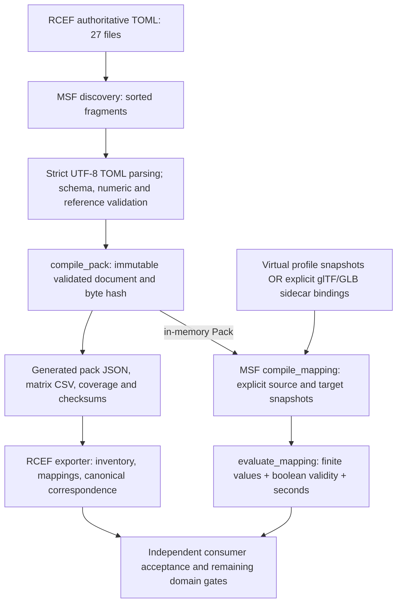
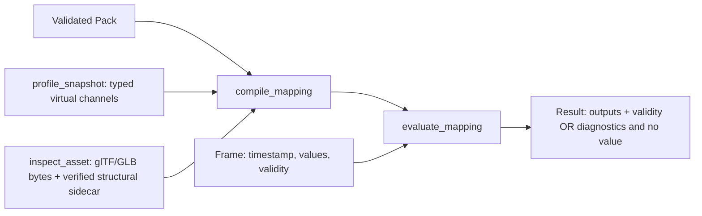

<!-- SPDX-License-Identifier: CC-BY-SA-4.0 -->
# RCEF architecture: from TOML to explicit scalar rules

RCEF inventories public expression interfaces and records explicit directional scalar mappings. TOML is the authoritative authoring format. MSF Tools supplies the parser, validator, deterministic pack compiler, mapping compiler and evaluator. RCEF adds its data, numerical fixtures, readable reports and consumer acceptance cases.

Read the [offline visual report](architecture.html) for the architecture diagram, file explorer and mapping demonstration. Static views are available as [SVG](architecture.svg) and [PNG](architecture.png). The [TOML index](toml-index.csv) lists every authoritative TOML path, table kind, count, byte length and SHA-256. Links in this guide are relative to `RCEF/docs`; shared-tool links assume a sibling `msf-tools` checkout.

## Scope of this report

This guide describes implemented source in the frozen `rcef.parity` data version **0.1.1**, schema **1.0**, operator **1.0**. Counts were recomputed from all 27 authoritative TOML files, and the merged data equals the supplied generated pack. These are inventory counts, including ancillary, excluded, unsupported and unresolved rows. They are neither selected-interface counts nor tracking-quality measurements.

| Measure | Recomputed total |
| --- | ---: |
| Distinct signal IDs | 893 |
| Profiles | 22 |
| Profile membership rows | 898 |
| Mapping records | 6 |
| Rules | 24 |
| Evidence records | 27 |
| Provider-specific canonical signals | 21 |

Five fixture signals occur in both the aggregate fixture profile and its source/target profiles: 5 distinct signals and 10 memberships. This explains the five-row difference. For example, `godot.blended.toml` contains 42 actual rows while its selected interface has 41; the index counts all actual rows. See the full [inventory](../reports/inventory.md).

Signal dispositions total 47 mapped, 805 unresolved, 6 unsupported and 35 excluded. Rules total 23 mapped (22 exact, 1 approximate) and 1 unresolved. A `mapped` signal does not guarantee that every requested mapping or frame can execute.

**Verification boundary:** this report was derived by static inspection and standard-library data parsing. The product compiler, evaluator, acceptance suites and browser controls were not executed to produce it. Implemented source behavior is described below; a fresh qualification result, installed dependency admission, device/capture validity and physiological calibration remain separate evidence requirements.

## 1. Architecture and ownership



Discovery, validation and pack compilation lead to separate runtime and artifact-export paths. The map/evaluate CLI reloads TOML and compiles an in-memory Pack for mapping; it does not read the generated JSON, matrix CSV or coverage files. The presentation exporter reads generated pack JSON directly; it does not consume scalar frames or render evaluated geometry. An evaluation `Report` containing diagnostics/losses is a different object from a readable Markdown/CSV presentation report.

| Owner | Supplies or implements | Boundary |
| --- | --- | --- |
| RCEF | `pack.toml`; provider/canonical inventories; profiles; evidence; directional mappings; numerical fixtures; `check.py`; report exporter; acceptance cases | Declares meaning and provenance; it does not implement the shared scalar algorithms. |
| MSF Tools | Authoring discovery/validation, `compile_pack`, `profile_snapshot`, `compile_mapping`, `evaluate_mapping`; explicit glTF/GLB inspection and sidecar binding | Implements the reviewed wire/operator contracts and rejection behavior. |
| Independent reviewer/consumer | Review changed bytes and semantics; run drift and acceptance gates with selected tools and any admitted native artifact | Executable correctness alone does not establish visual, anatomical, cross-provider or physiological equivalence. |

Sources: [RCEF launcher](../check.py), [MSF authoring](../../msf-tools/msf_tools/authoring.py), [pack compiler](../../msf-tools/msf_tools/pack.py), [mapping compiler/evaluator](../../msf-tools/msf_tools/mapping.py), [presentation exporter](../scripts/export_reports.py), [acceptance runner](../scripts/run_acceptance.py).

## 2. How TOML is discovered and interpreted

`load_authoring` accepts a single TOML file or a directory containing `pack.toml`. A single file must contain the complete authoring document, including all four top-level arrays. Directory loading initializes the four arrays and merges discovered fragments.

Directory discovery recursively includes names ending in lowercase `.toml`. It prunes entries whose names begin with `.` and entries named `generated`, rejects symlinks in the visited authoring tree, and globally sorts file paths before merging. Portable fragment checks reject case-insensitive path collisions and reserved filename components. Discovery has resource limits and requires the filesystem capabilities used by the shared tools; source inspection here does not qualify a host.

**Folder names do not choose a schema.** `profiles/`, `mappings/`, `data/` and `evidence/` describe the repository's organization. The actual top-level keys in each parsed file determine what gets appended. A new TOML file anywhere in the discovered tree participates, including a future TOML example placed under `docs/`. Keep standalone authoring examples outside that tree or inside Markdown code fences.

| Current location | Actual role | Files | Signals | Profiles | Memberships | Mappings / rules | Evidence |
| --- | --- | ---: | ---: | ---: | ---: | ---: | ---: |
| [pack.toml](../pack.toml) | Root metadata | 1 | 0 | 0 | 0 | 0 / 0 | 0 |
| [data/canonical.toml](../data/canonical.toml) | Provider-specific projections and canonical profile | 1 | 21 | 1 | 21 | 0 / 0 | 0 |
| [profiles/fixture.toml](../profiles/fixture.toml) and provider profile fragments | Signal arrays plus profile arrays | 19 | 872 | 21 | 877 | 0 / 0 | 0 |
| [mappings/fixtures.toml](../mappings/fixtures.toml) and other mapping fragments | Directional rule arrays | 5 | 0 | 0 | 0 | 6 / 24 | 0 |
| [evidence/sources.toml](../evidence/sources.toml) | Evidence array | 1 | 0 | 0 | 0 | 0 / 0 | 27 |

The five root metadata keys appear once across a directory. A repeated metadata key is rejected even if its value is identical. Top-level `signals`, `profiles`, `mappings`, `evidence` must be arrays and are appended in file order, preserving each file's array order.

### Actual pack metadata and versions

[pack.toml](../pack.toml) contains these five scalar keys; it contains no file-list or parser-option keys:

```toml
schema_version = "1.0"
data_version = "0.1.1"
operator_version = "1.0"
id = "rcef.parity"
license = "CC-BY-SA-4.0"
```

The merged document requires all five keys and the four arrays. Schema and operator versions currently accept only `"1.0"`; `data_version` is independently versioned and must match the validator's semantic-version spelling (three numeric components, optionally a prerelease suffix). Do not invent version-dependent operators or extra root keys.

### Arrays, tables and references

- `[[signals]]`, `[[profiles]]`, `[[mappings]]`, `[[evidence]]` append records to top-level arrays. `[signals]` would create an object instead and fails the array requirement.
- `signal_ids = ["a", "b"]` is an ordered string array. `rules = [{...}, {...}]` is an ordered array of inline objects. Repeated `[[mappings.rules]]` tables are the expanded spelling for a mapping's rule array.
- `domain = { min = 0.0, max = 1.0 }` is a nested object. A `[signals.domain]` table after `[[signals]]` describes the latest signal's domain. Table scope persists: put signal fields before opening its nested tables. `[mappings.rules.operator]` describes the latest rule's operator.
- TOML dotted **keys** create nested objects. Dots inside a string **ID** are literal characters, not navigation. `"arkit.coefficient.eyeBlinkLeft"` must be referenced exactly; changing `Left` to `left` changes the ID.
- IDs are nonblank strings, case sensitive, preserved without trimming or normalization. Signal/profile/mapping/evidence IDs are unique within their category; rule IDs are unique across all mappings. String-reference arrays reject duplicate entries.
- Profile `signal_ids`, rule `inputs`/`outputs` and evidence-reference arrays must name existing records. `label`, `native_id`, `region`, `side` and anatomical resemblance are not reference aliases.
- JSON object keys are sorted when serialized; arrays retain authoring order. Profile column order follows profile order. Weighted-sum weights match input order. Compilation repeatedly appends all currently dependency-ready rules in authored order. Dependencies execute first; authored order is preserved within each ready batch. Independent rules in different batches may change relative order.

Parsing is strict UTF-8 via `tomllib.loads`, after bounded parsing preflight. TOML syntax/duplicate-key errors precede schema checks. The MSF validator rejects unknown structural keys, missing keys, invalid enums, duplicate IDs, dangling references and invalid numeric/domain declarations. The document must be JSON-compatible: TOML dates/times are not accepted as typed signal values, and NaN/infinity or boolean scalars are refused. This pipeline does not execute text from TOML or infer conversions from provider names.

Sources: `load_authoring`, `validate_authoring`, `_authoring_files` in [authoring.py](../../msf-tools/msf_tools/authoring.py); `_scan_directory`, `_toml_text`, `_toml_document` in [common.py](../../msf-tools/msf_tools/common.py).

## 3. Authoring field reference

These tables describe the actual strict validator. Opaque format-specific inventory details belong inside `metadata`; arbitrary extra keys elsewhere are not extensions.

### Signals

| Fields | Requirement and meaning |
| --- | --- |
| `id`, `label` | Required nonblank identity and display name. |
| `value_type` | Required; currently only `"scalar"`. |
| `units`, `calibration` | Required nonblank strings; declare quantity and basis explicitly. `"unknown"` units preserve uncertainty; a calibration string is a declaration, not a measurement procedure. |
| `domain` | Required object with only optional finite `min`, `max`. `{}` declares no bounds; `min <= max` when both present. |
| `disposition` | Required `mapped`, `unsupported`, `unresolved` or `excluded`. Preserves inventory even when a record cannot execute. |
| `evidence`, `evidence_status` | Required evidence-ID array (can be empty in inventory) and `verified_current`, `proposed` or `unresolved`. Execution is stricter. |
| `neutral`, `native_default` | Independently optional finite numbers within domain. Neutral is the stated calibrated reference; native default is storage initialization. Neither is an automatic runtime fallback. |
| `region`, `side`, `native_id`, `surface`, `time` | Optional nonblank descriptive strings. Time text does not convert a provider clock. |
| `coupling` | Optional nonblank description or array of unique nonblank descriptions. Does not create a runtime state policy. |
| `validity` | Optional boolean or nonblank description. Describes the source contract; actual frame validity is supplied separately. |
| `confidence` | Optional nonblank description or finite number in [0,1]. Does not imply a threshold. |
| `metadata` | Optional object for explicit inventory details, reasons and definitions; it does not execute. |

For the real ARKit left blink input and canonical output: scalar, units `1`, domain `[0,1]`, side `left`, neutral `0.0`, and the same explicit calibration:

`arkit.coefficient.v1:eyeBlinkLeft: face-relative native neutral-to-maximum coefficient`

The input's native ID is `eyeBlinkLeft`. Its canonical counterpart is `rcef.arkit.coefficient.eyeBlinkLeft`; the latter keeps the provider basis. See [ARKit source record](../profiles/arkit.coefficient.toml) and [canonical definitions](../data/canonical.toml).

### Profiles and evidence

| Record | Required fields | Optional fields / constraints |
| --- | --- | --- |
| Profile | `id`, `label`, `signal_ids` | `evidence`, `metadata`. Membership is an ordered array of signal IDs; it does not duplicate signal definitions. |
| Evidence | `id`, `claim`, `status` | Exactly `url`, `revision`, `retrieved`, `sha256`, `locator`, `license`, `authorship`; values are nonblank strings. |
| Public evidence | Evidence fields, HTTPS `url`, `locator`, at least one of `revision` / `retrieved` / `sha256` | A provided digest is exactly 64 lowercase hexadecimal characters. The current source verifier needs digests on the URL records it fetches. |
| Original evidence | Evidence fields, `license`, `authorship` when no URL | `rcef_definitions` attributes the original provider projections and synthetic fixtures to RCEF contributors (2026), CC-BY-SA-4.0. |

Example evidence: `apple_blendshapes` claims 52 coefficient identifiers, native 0..1 domain and face-relative sides. It records locator `topicSections except initializer; Discussion`, retrieval `2026-10-07`, revision `retrieval-digest`, and digest `50691c512eedecaa3e54b73f313816409ff47b8b1bd3628460ca2c096903009b`. This binds the cited source bytes; it does not measure a face. See [sources.toml](../evidence/sources.toml).

### Mappings, rules and loss annotations

| Record / fields | Actual contract |
| --- | --- |
| Mapping `id`, `rules` | Both required; no additional mapping-level keys. Source/target profiles are selected explicitly at compilation, not declared as mapping fields. |
| Rule `id`, `inputs`, `outputs`, `operator` | Required; ordered nonempty input/output ID arrays. All operators produce exactly one scalar output. |
| Rule `disposition`, `assumptions`, `evidence`, `evidence_status`, `loss_annotations` | Required. Assumptions/evidence are string arrays; losses are object arrays. |
| Rule `mapping_quality` | Required only for mapped rules: `exact` or `approximate`. Forbidden on nonmapped rules. |
| Rule `coupling` | Optional description or string array, with the same spelling rules as signals. |
| Loss `category`, `effect`, `reason`, `refs` | Required. Categories: `signal`, `geometry`, `binding`, `animation`, `material`, `metadata`. Effects: `preserved`, `approximated`, `dropped`, `unknown`. `refs` is an explicit string array. |
| Loss `units`, `bound` | Optional nonblank units, finite nonnegative bound. Do not invent a numerical bound when none is authored. |

`disposition` answers whether the author has admitted the relationship; `evidence_status` describes its evidence; `mapping_quality` describes the admitted mapping's quality. These are separate fields. Direction is the ordered `inputs → outputs` relationship. A rule does not imply an inverse.

Source: `validate_signal`, `validate_rule`, `loss_annotation`, `validate_authoring` in [authoring.py](../../msf-tools/msf_tools/authoring.py).

## 4. Exact examples from the implemented operators

### Real ARKit identity

The following is the existing left-blink rule, expanded into nested tables for readability. It is an excerpt of `arkit.to_canonical`, which contains nine rules; it is not a complete standalone pack. The source stores rules as inline object arrays.

```toml
[[mappings]]
id = "arkit.to_canonical"

[[mappings.rules]]
id = "arkit.coefficient.eyeBlinkLeft.identity"
inputs = ["arkit.coefficient.eyeBlinkLeft"]
outputs = ["rcef.arkit.coefficient.eyeBlinkLeft"]
disposition = "mapped"
mapping_quality = "exact"
assumptions = [
  "Valid scalar sample supplied with native calibration arkit.coefficient.v1:eyeBlinkLeft: face-relative native neutral-to-maximum coefficient.",
  "Output preserves native coefficient meaning only; no cross-provider or visual equivalence.",
]
evidence = ["apple_blendshapes", "rcef_definitions"]
evidence_status = "verified_current"
loss_annotations = []

[mappings.rules.operator]
id = "identity"
```

`y = x`, so a valid `0.25` yields `0.25`. Identity compilation also requires equal units, value type, domain, calibration and equal presence/value of neutral, side and coupling. It preserves this provider coefficient only. See [arkit.toml](../mappings/arkit.toml).

### Real affine fixture

`fixture.affine.convert` maps `fixture.affine.signed → fixture.affine.unit` with `{ id = "affine", scale = 0.5, offset = 0.5 }`, mapped/exact, current evidence and no loss annotations. The signed input domain is `[-1,1]` with calibration `fixture.signed.v1`; the output is `[0,1]` with `fixture.unit.v1`. Its authored assumption matches synthetic low/mid/high at -1/0/1 and 0/0.5/1.

| Input x | Binary64 multiply, then add: y = (0.5 × x) + 0.5 |
| ---: | ---: |
| -1 | 0 |
| 0 | 0.5 |
| 1 | 1 |
| 0.5 | 0.75 |

These values are exactly representable. There is no implicit clamp or inverse mapping. See [fixture rules](../mappings/fixtures.toml), [fixture channels/profiles](../profiles/fixture.toml), and [stored numerical examples](../fixtures/mapping_samples.json).

### Real weighted-sum fixture

`fixture.brow.collapse` maps `[fixture.brow.left, fixture.brow.right] → fixture.brow.shared`, using ordered weights `[0.5,0.5]`. It is mapped/**approximate**, `coupling="bilateral_shared"`, with the authored reason `asymmetry irrecoverable` for signal approximation and `No geometry evaluated by scalar fixture.` for geometry effect `unknown`. No numerical loss bound is authored.

The runtime starts at `0.0`, multiplies each input by its corresponding weight, and adds each term in input order: `y = (0.0 + 0.5×left) + 0.5×right`. It does not normalize weights. `(1,0)` and `(0,1)` both yield `0.5`; `(0,0)` yields `0`; `(1,1)` yields `1`. Execution requires explicit `allow_approximation=True` (CLI `--allow-approximation`), including for declared losses with effect approximated/dropped/unknown. This synthetic arithmetic mean is not a proposed anatomical or cross-provider mapping.

Only three operators exist here: `identity` (one input), `affine` (one input, explicit finite scale and offset), `weighted_sum` (N inputs, exactly N finite ordered weights). All have one output. Checked binary64 primitives refuse nonfinite arithmetic and nonzero products that underflow to zero. Weighted sums use ordered addition, not compensated summation; affine multiplication and addition are separate operations, not a fused multiply-add.

Sources: operator dispatch in [mapping.py](../../msf-tools/msf_tools/mapping.py) and `_product`, `_add`, `_sum` in [math3d.py](../../msf-tools/msf_tools/math3d.py). The visual report's sliders restrict inputs to exactly representable dyadic steps and show this fixture arithmetic; they are an explanatory demonstration, not the product evaluator.

## 5. Runtime admission, validity and asset binding



### Mapping compilation is stricter than inventory validation

A well-formed unresolved inventory can compile into a pack. A requested mapping must have mapped participating signals/rules, nonempty own evidence, compatible endpoint evidence and compatible channel declarations. A current rule requires current endpoints; a proposed rule can use current/proposed endpoints. Current records need current evidence references; proposed records can use current/proposed references. Participating unresolved evidence refuses execution. Unused inventory remains visible. Approximation opt-in does not bypass these checks.

Compilation rejects unknown channels, multiple writers/competing source drivers and dependency cycles. Compilation repeatedly appends all currently dependency-ready rules in authored order. Dependencies execute first; authored order is preserved within each ready batch. Independent rules in different batches may change relative order. Virtual intermediate outputs are allowed; terminal outputs must be present in the target snapshot. Unit changes require explicit affine coefficients and assumptions. Nonidentity basis changes or declared approximation/loss require an authored derivation; the validator does not prove the derivation's domain meaning.

[unresolved.toml](../mappings/unresolved.toml) deliberately records `survey.mediapipe_arkit.blink` as unresolved with unresolved evidence status and no quality. Its identity operator spelling does not admit the relationship. The authored reason is that names alone cannot establish model/provider calibration.

### Actual frame shape and failure behavior

A frame array for the **affine** fixture can contain this actual source channel:

```json
[
  {
    "timestamp": 0.0,
    "values": {"fixture.affine.signed": 0.0},
    "validity": {"fixture.affine.signed": true}
  }
]
```

With source `fixture.source`, target `fixture.target` and mapping `fixture.affine`, the derived output is `fixture.affine.unit: 0.5`, validity `true`. Required inputs are the mapping's external inputs; other source-profile channels may be omitted when that mapping does not require them. The stored `mapping_samples.json` is a numerical expectations fixture, not this evaluator frame format. For `arkit.to_canonical`, all nine rule inputs are required; a lone blink value does not run the complete nine-rule mapping.

| Frame condition | Implemented behavior |
| --- | --- |
| Timestamp missing / extra frame keys | Exact frame-key validation refuses the frame. Timestamp must be nonnegative finite seconds, excluding bool. |
| Supplied value lacks validity (or vice versa), or validity is not a boolean | `E_VALIDITY`. |
| Required input absent from both objects | `E_MISSING_SAMPLE`. |
| Finite in-domain input with validity `false`, including a value equal to neutral | `E_INVALID_SAMPLE`; no neutral/default substitution. |
| Unknown or non-source channel supplied | `E_SAMPLE_REFERENCE`. |
| Nonfinite, boolean or out-of-domain value | Numeric/domain diagnostic; no clamping. Values are checked before and after operators. |
| Any frame has an error | The entire Result has `value=None`; callers must check `.ok` and diagnostics. |
| Valid frames | Output frame order is preserved; written output validity is `true`. No smoothing, resampling or hidden state. |

Signal-level `validity`, `confidence`, `time` are descriptions of a provider contract, not executable expressions. For example, FB2 gaze records state `isValid AND isEyeFollowingBlendshapesValid`, upper/lower confidence with no implied threshold, and `XrTime` requiring explicit conversion to seconds. The caller must supply the actual boolean and time conversion. The `opposing_direction_exclusive` coupling declaration is not a runtime mutual-exclusion check; direction-focused cases should activate one direction at a time.

### Neutral, native defaults and unresolved quantities

ARKit blink declares neutral `0.0`. VRCFT left/right raw openness instead declares `native_default=1.0` and no neutral, with `initialization_is_measured_neutral=false`. Both raw openness identities retain storage meaning. Left/right raw `PupilDiameter_MM` records have units `mm`, unbounded declared domains and storage-specific calibration; this does not qualify the physical measurement.

`vrcft.eye.Combined.PupilDiameter_MM` has units `1`, domain `[0,1]`, metadata quantity `normalized dilation`, dynamic extrema, normalization execution unsupported, and unresolved disposition. Its name must not be treated as millimetres. Combined openness and combined gaze/state policy also remain unresolved. A documented code/documentation contradiction in combined gaze stays visible; this report infers no replacement rule. See [vrcft.eye.toml](../profiles/vrcft.eye.toml), [vrcft_eye mappings](../mappings/vrcft_eye.toml) and [canonical definitions](../data/canonical.toml).

The 21 canonical projections comprise 9 ARKit identities, 8 FB2 directional gaze identities and 4 VRCFT raw-eye identities. FB2 values are native direction-specific angle fractions with unspecified maximum angle; no radians are inferred. Canonical does not mean one universal anatomy or interchangeable calibration.

### Authoring mapping versus asset binding

`profile_snapshot(pack, id)` creates typed virtual channels from a named profile. A mapping rule links those signal IDs with arithmetic. An asset binding separately connects a signal to a structural glTF/GLB mesh-instance morph target, using matching `value_type`, `units`, `domain`, `calibration` and a `ref` with `asset_sha256`, `locator`, `node`, `mesh`, `target` and optional `resource_sha256`.

The locator must agree with `/nodes/{node}/weights/{target}`, the node's mesh and target index. A sidecar contains `schema_version`, `asset_sha256`, `resource_hashes`, `bindings`, optionally `metadata`; reuse verifies exact asset/consumed resource hashes. Names alone do not bind a target. `annotate_asset` creates a sidecar and leaves original asset bytes unchanged. Asset-based CLI mapping requires explicit sidecars; profile-based scalar fixtures need no asset.

MSF's asset inspection accepts glTF/GLB (JSON glTF aliases `json`/`gltf2`); aliases are not extra format support. Geometry implementation has a separate limited position/morph/four-influence LBS/animation scope. Provider inventories for VRM, Roblox and other surfaces do not implement loaders for those formats or prove geometry/material/visual equivalence. See [snapshot.py](../../msf-tools/msf_tools/snapshot.py) and [shared reference](../../msf-tools/docs/reference.md).

## 6. Generated artifacts and presentation reports

| Artifact | Producer and use |
| --- | --- |
| [generated/rcef.pack.json](../generated/rcef.pack.json) | MSF `compile_pack` and CLI serialization: complete validated document; immutable API Pack identity hashes canonical bytes. It does not compile executable mapping instructions. |
| [generated/rcef_mapping.csv](../generated/rcef_mapping.csv) | MSF signal/profile membership matrix: one row per distinct signal, one column per profile. The filename does not make it an executable rule table. |
| [generated/coverage.json](../generated/coverage.json) | MSF coverage: dispositions, quality partitions, per-profile memberships, evidence and rule uses; binds pack hash. |
| [generated/SHA256SUMS](../generated/SHA256SUMS) | Exact hashes of pack, matrix CSV and coverage, in that order; excludes itself. |
| [reports/inventory.md](../reports/inventory.md), [CSV](../reports/inventory.csv) | RCEF exporter: 898 membership rows with original names, indices, domains, evidence, neutral/default and reasons. |
| [reports/mappings.md](../reports/mappings.md), [CSV](../reports/mappings.csv) | RCEF exporter: 24 authored directional rules and their status, operators, assumptions and losses. |
| [reports/canonical_correspondence.md](../reports/canonical_correspondence.md), [CSV](../reports/canonical_correspondence.csv) | RCEF exporter: 21 canonical projections against authored relationships; a dash means no authored rule. Unresolved relationships remain labeled. |
| [reports/SHA256SUMS](../reports/SHA256SUMS) | Exact hashes of the six presentation files, sorted by filename; excludes itself. Markdown presentation reports record the consumed pack SHA-256. |

JSON uses sorted object keys, indent=2, UTF-8 with final LF, finite numbers and normalized negative zero. Arrays retain authoring order. CSV uses UTF-8, LF and minimal standard CSV quoting. All shared output bytes are rendered before file publication. Each file is atomically replaced individually; the four generated files plus seven presentation files are not one transaction. Review all outputs after a failure and rerun the check.

## 7. Practical edit → regenerate → check → qualify workflow

These are suggested commands for an authorized author in an RCEF checkout using Python 3.11+. They were not executed for this report.

1. Identify the affected signal/profile/rule and its exact evidence IDs. Edit the authoritative TOML, retain unresolved facts, and update evidence locators/digests where appropriate. Keep measured neutral, storage defaults and actual sample validity distinct.
2. Select the reviewed MSF dependency. `check.py` without `--tools-path` imports the installed `msf_tools` with the running interpreter. `--tools-path` explicitly prepends a checkout containing `msf_tools/__init__.py` for that invocation; it does not install, clone, download or verify release-package provenance. `check.py` does not select the checkout from `MSF_TOOLS_PATH` automatically.
3. Regenerate, review changed generated/presentation bytes, and check again. `--write` is regeneration; the default invocation is byte drift checking, not full qualification.
4. Run independent acceptance with the same selected tools and any admitted native artifact. Keep device/capture and calibration gates separate.

Installed-package rendering/checking:

```sh
python3 -B check.py --write
python3 -B check.py
```

Explicit sibling checkout for rendering and acceptance (choose the reviewed checkout first):

```sh
export MSF_TOOLS_PATH="../msf-tools"
export PYTHONPATH="$MSF_TOOLS_PATH"
python3 -B check.py --tools-path "$MSF_TOOLS_PATH" --write
python3 -B check.py --tools-path "$MSF_TOOLS_PATH"
python3 -B scripts/run_acceptance.py --tools-path "$MSF_TOOLS_PATH"
```

`PYTHONPATH` selects the same tools for subprocess tests. The acceptance runner requires `--tools-path` or `MSF_TOOLS_PATH`, verifies the imported source origin, discovers all `tests/test_*.py`, and enforces the pinned required method coverage. A drift check is necessary alongside the qualification runner. Merely generating matching bytes does not run those tests.

`check.py` first delegates to `msf_tools check` for the pack, CSV, coverage and generated checksums. If that fails, it stops before presentation export. On shared success it runs the RCEF presentation exporter with the same write/check choice. For presentation-only regeneration/checking of an existing pack:

```sh
python3 -B scripts/export_reports.py --write
python3 -B scripts/export_reports.py
```

The native backend is a separately configured pilot. Without native configuration, eligible skips may be admitted and the run remains **native unqualified**. With a configured native path, an accepted module SHA-256 and matching import origin are mandatory; all required tests must run with zero skips. A path/digest gate alone does not admit an installed or release wheel. The report makes no fresh native qualification claim.

Optional configured-native invocation after independent artifact admission:

```sh
python3 -B scripts/run_acceptance.py --tools-path "$MSF_TOOLS_PATH" \
  --native-path "$MSF_NATIVE_PATH" --native-sha256 "$MSF_NATIVE_SHA256" --require-native
```

Optional public-source provenance verification, with an explicit cache outside the RCEF repository:

```sh
export RCEF_SOURCE_CACHE="../rcef-source-cache"
python3 -B scripts/verify_sources.py --source apple_blendshapes --cache "$RCEF_SOURCE_CACHE"
python3 -B scripts/verify_sources.py --cache "$RCEF_SOURCE_CACHE"
python3 -B scripts/audit_inventories.py --cache "$RCEF_SOURCE_CACHE"
```

The first command verifies only the named evidence source. The inventory auditor needs the full set of source IDs it uses; populate the complete cache with `verify_sources.py --cache "$RCEF_SOURCE_CACHE"` before auditing all inventories. Digest mismatch requires source review rather than silently accepting new bytes. These optional tools verify source provenance and selected names/order/native indices. They do not establish physiological calibration, capture validity or visual equivalence.

Before extension/release, read [CONTRIBUTING](../CONTRIBUTING.md), [GOVERNANCE](../GOVERNANCE.md), [references](../references.md) and [third-party notices](../THIRD_PARTY_NOTICES.md).

## 8. Independent validation checklist

- Recompute all 27 TOML counts and uniqueness/reference relationships; compare the merged data to the frozen/current pack. Count memberships independently from distinct signals and selected-interface metadata.
- Review the exact ARKit calibration/domain/neutral/side/coupling checks. Verify independent expected values for identity `0.25`, affine `-1/0/1 → 0/0.5/1`, and ordered bilateral pairs. Require approximation opt-in and retain both authored losses.
- Exercise missing value/validity, false/nonboolean validity, absent required inputs, extra/non-source channels, nonfinite/out-of-domain values and a failing frame in a multi-frame batch. Require no evaluated Result value on error.
- Confirm unresolved MediaPipe→ARKit execution refuses; distinguish evidence status from disposition and quality. Do not infer inverse or cross-provider rules from names.
- Run the no-write drift check and full acceptance with a reviewed tools origin. Review any unconfigured-native skips; require admitted native path/hash, complete methods and zero skips for native qualification. Treat installed-package admission separately.
- Independently review the HTML in offline, narrow-screen and print modes. Tab through the stage/file explorer, operate selectors and sliders with the keyboard, test reset and invalid/missing modes, and compare all static and displayed fixture values. Check readable content with JavaScript disabled and with a screen reader.
- Check relative links after adoption into `RCEF/docs` with sibling `msf-tools`, and verify MIT inline code plus CC-BY-SA-4.0 original-documentation attribution.

## Licensing

Original documentation, diagrams and CSV arrangement: **CC BY-SA 4.0**, RCEF contributors (2026). Inline JavaScript in the visual report: **MIT**, RCEF contributors (2026). Referenced provider material retains its own terms; see [licenses](../LICENSES/CC-BY-SA-4.0.txt), [MIT](../LICENSES/MIT.txt) and [THIRD_PARTY_NOTICES](../THIRD_PARTY_NOTICES.md).
